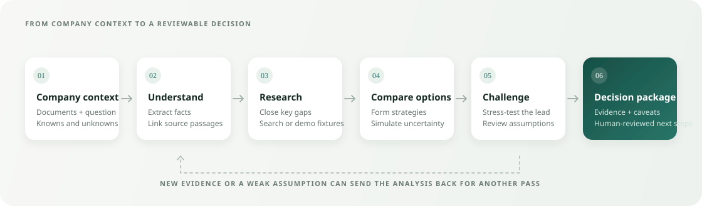

# Kairo — Strategic Decision Intelligence

<p align="center">
  <strong>Turn company knowledge into decisions you can inspect, challenge, and test.</strong>
</p>

<p align="center">
  
  
  
</p>

Kairo is a private workspace for exploring consequential business decisions. It organizes company documents into a source-backed company twin, compares strategic options, simulates financial uncertainty, and records the assumptions and evidence behind each result.

> **Project status:** The browser workspace and its SQLite-backed `/api/cases` workflow are the active user-facing experience. The newer `backend/dtp/` platform is a separate prototype: it includes PostgreSQL-backed services and numerical components, but its orchestration path currently blocks decision release until verified draft lineage is connected. See [implementation status](docs/implementation-status.md) for detail.

## Why Kairo

- **Keep facts traceable.** View extracted company facts, source passages, unknowns, and owner corrections together.
- **Compare real alternatives.** Generate distinct strategic hypotheses and examine their financial outcomes under uncertain inputs.
- **Challenge the favorite.** An adversarial review looks for weaknesses in the leading option and can trigger further research.
- **Keep a decision history.** Review versioned runs, inspect approval assumptions, discuss results, and export PDF, CSV, or JSON.
- **Use a human checkpoint.** Review and adjust consequential assumptions before the final simulation.

## How a decision moves through the system

<p align="center">
  
</p>

1. **Add context** by uploading company documents or describing the business in a prompt.
2. **Build the source twin** with extracted facts, evidence links, and explicit unknowns.
3. **Choose a decision question** and let the planner identify important information gaps.
4. **Research and compare** competing strategies using available evidence and simulations.
5. **Review assumptions** at the human approval checkpoint, then inspect the final decision package.

The current browser workflow is implemented in `backend/workspace_api.py` and `backend/agents/`. The separate `backend/dtp/` modules are not the browser's decision engine.

## Technology

| Area | Stack |
| --- | --- |
| Web app | React 19, TypeScript, Vite |
| API | Python, FastAPI, Pydantic |
| Agent workflow | LangGraph |
| Workspace records | SQLite (users, sessions, cases, documents, runs, and events) |
| Document retrieval | ChromaDB and local Sentence Transformers embeddings (`all-MiniLM-L6-v2`) |
| Language models | Any compatible OpenAI-style endpoint, including hosted providers or a local server |
| Optional web research | Tavily or SerpAPI; demo fixtures are available with `DEMO_MODE=true` |

## Quick start

### Requirements

- Python 3.13 or newer
- Node.js and npm
- An OpenAI-compatible LLM endpoint; hosted providers generally require an API key

### 1. Configure the environment

From the repository root:

```bash
cp .env.example .env
```

Set your model provider and create a unique workspace login in `.env`:

```dotenv
LLM_BASE_URL=https://api.openai.com/v1
LLM_API_KEY=your-api-key
LLM_MODEL=gpt-4o-mini

STRATEGY_DEMO_EMAIL=you@example.com
STRATEGY_DEMO_PASSWORD=replace-with-a-long-unique-password
```

For a local provider such as Ollama, set `LLM_BASE_URL` to its OpenAI-compatible URL. Add `TAVILY_API_KEY` or `SERPAPI_KEY` to enable live search; set `DEMO_MODE=true` to use fixtures instead.

### 2. Install dependencies and build the web app

```bash
python -m venv .venv
source .venv/bin/activate        # Windows PowerShell: .venv\Scripts\Activate.ps1
pip install -r backend/requirements.txt
cd frontend
npm ci
npm run build
cd ..
```

### 3. Start Kairo

```bash
python backend/main.py
```

Open [http://localhost:8000](http://localhost:8000) and sign in with the email and password configured above. For frontend development with hot reload, start the API as above, then in another terminal run:

```bash
cd frontend
npm run dev
```

Vite proxies `/api` requests to the API on port `8000`.

## Try a sample decision

Start a case with a question such as:

> For a modular kitchen storage starter kit with a unit cost of ₹180, monthly fixed costs of ₹45,000, and a ₹3,00,000 marketing budget, what price and distribution channel should we test in India?

Or upload a company brief first. The workspace supports PDF, DOCX, CSV, TXT, and Markdown documents, subject to the configured file size limit. Then inspect the extracted company facts, select a decision question, and review the evidence, simulations, and assumptions as the run progresses.

## Configuration

Settings are read from `.env`; defaults are defined in `backend/config.py` and `backend/workspace_api.py`.

| Variable | Purpose | Default |
| --- | --- | --- |
| `LLM_BASE_URL` | OpenAI-compatible model endpoint | `https://api.openai.com/v1` |
| `LLM_API_KEY` | Provider credential (not needed for local endpoints) | empty |
| `LLM_MODEL` | Model identifier | `gpt-4o-mini` |
| `LLM_TIMEOUT_SECONDS` | Timeout for an individual model request | `45` |
| `LLM_MAX_RETRIES` | Retries after a model request fails | `1` |
| `EMBEDDING_MODEL` | Local text embedding model | `all-MiniLM-L6-v2` |
| `TAVILY_API_KEY` | Optional live search credential | empty |
| `SERPAPI_KEY` | Optional secondary search credential | empty |
| `DEMO_MODE` | Use research fixtures rather than live search | `false` |
| `STRATEGY_DEMO_EMAIL` | Initial workspace account email | empty |
| `STRATEGY_DEMO_PASSWORD` | Initial workspace account password | empty |
| `STRATEGY_DB_PATH` | Workspace SQLite database path | `./data/workspace.sqlite3` |
| `STRATEGY_COOKIE_SECURE` | Mark session cookie Secure (enable behind HTTPS) | `false` |
| `PORT` | API port | `8000` |
| `CASE_TIMEOUT_SECONDS` | Maximum decision workflow duration | `1200` |

The PostgreSQL service in `docker-compose.yml` supports the separate DTP prototype. It is not required to run the browser workspace. Configure `POSTGRES_OWNER_PASSWORD` and `POSTGRES_APP_PASSWORD` before starting that service.

## Project layout

```text
backend/
  agents/       Current browser decision workflow
  dtp/          Separate PostgreSQL-backed platform prototype
  rag/          Document ingestion and retrieval
  workspace_api.py
  workspace_store.py
  main.py
frontend/       React and TypeScript app
docs/           Architecture and implementation notes
data/           Local uploads, indexes, and runtime data
```

## Known limitations

- Recommendations depend on the quality and coverage of supplied company data and available research. Treat model-generated claims and forecasts as inputs for review, not as guaranteed outcomes.
- Demo fixture research is labeled in results and exports; it is not live market evidence.
- Scanned PDFs need OCR or a text-based copy before their content can be indexed.
- The current `/api/cases` workspace uses SQLite and the `backend/agents/` workflow. PostgreSQL-backed `backend/dtp/` components are a distinct prototype and are not wired in as its replacement.
- The legacy `/api/upload` and `/api/case` endpoints do not use the private workspace's authentication flow. Do not expose those legacy endpoints on a public deployment until their access model is resolved.

## Development checks

```bash
PYTHONPATH=backend python -m pytest tests/test_workspace_api.py -q -p no:cacheprovider
cd frontend && npm run build
```

The DTP database integration checks require a configured PostgreSQL service; consult [implementation status](docs/implementation-status.md) for current verification notes.
