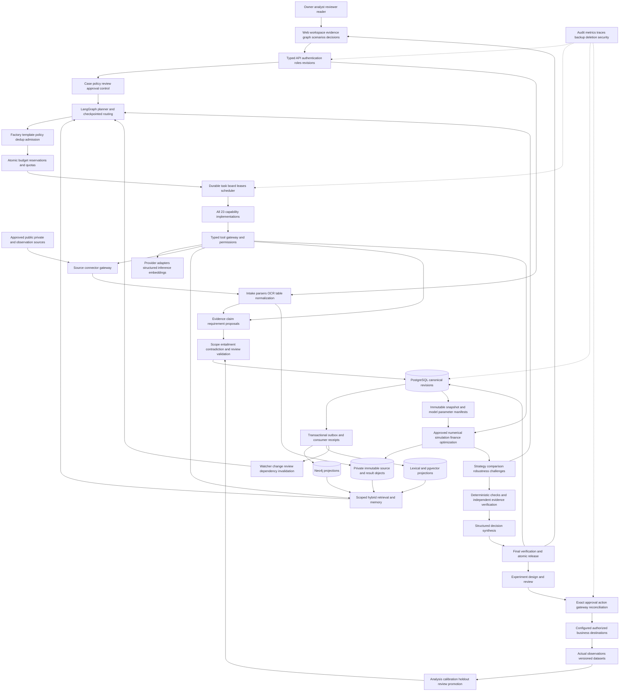
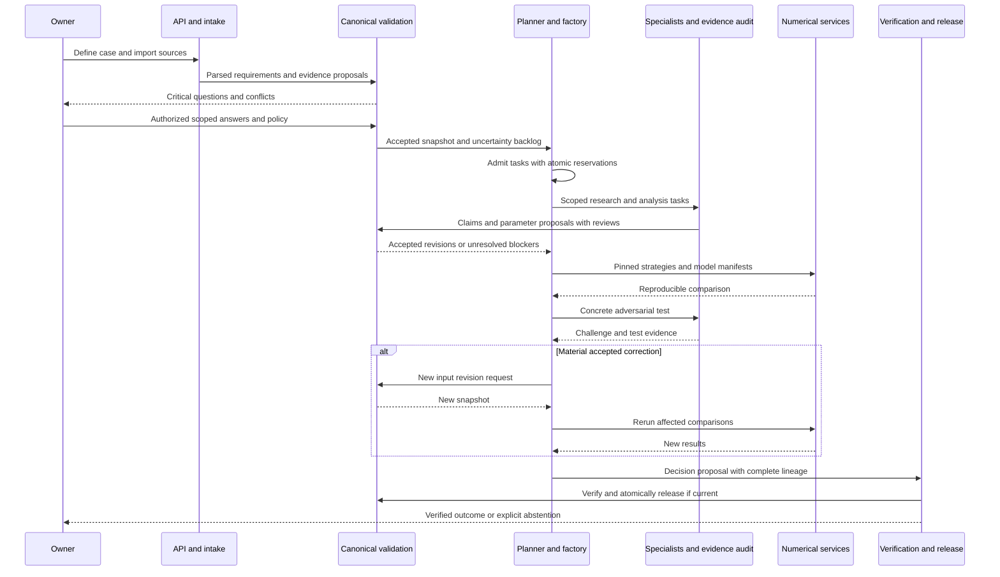
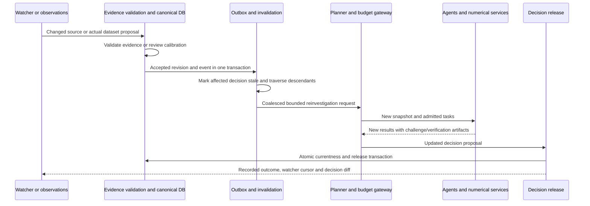
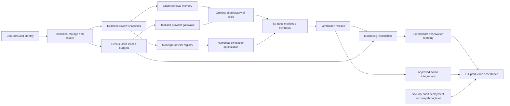

# Architecture, Data Relationships and Runtime Interworking

Version 1.0 · Normative companion to SRS-003, SRS-016–027 and SRS-048–062

These are logical boundaries. A modular application can implement several in one deployment; separate numerical/parsing workers provide resource isolation. The complete system requires all functions, not a particular microservice count.

## 1 Complete component architecture

Canonical records plus the outbox are transactional. Graph/vector views are derived and may lag. A query requiring an exact snapshot either resolves canonical facts for that snapshot or waits/fails with a declared projection lag; it cannot silently combine incompatible current indexes with an older snapshot. Objects are written before referenced commits with hash verification; unreferenced objects are reconciled/garbage-collected according to policy after crash recovery.

## 2 Trust and ownership boundaries

| Boundary | Untrusted input | Enforcement | Authoritative output |
|---|---|---|---|
| Browser -> API | IDs, role claims, edits, files | Authenticated scope, schemas, revision guards, upload limits | Validated command/job receipt |
| Source -> intake | Web/document text, tables, dates, embedded instructions | Parser sandbox, extraction provenance, no instruction authority | Immutable parsed proposals |
| Agent -> tool | Model-selected args and task requests | Allowlist, tenant scope, budgets, schema and domain checks | Typed result/proposal, never unrestricted mutation |
| Evidence -> accepted knowledge | Claim/parameter proposals | Entailment, applicability, units, materiality review | Immutable accepted revision or rejection |
| Model -> numerical service | Parameters, scenario patch, action vector | Approved model/parameter manifest, ranges, compute cap | Reproducible result and diagnostics |
| Draft -> released decision | Narrative, ranks, citations | Mandatory verification plus currentness transaction | Single current decision pointer/version |
| Plan -> external effect | Recipient, price, spend, payload | Exact approval hash, expiry, scope, idempotency | Receipt or UNKNOWN pending reconciliation |
| Observations -> learning | Datasets and outcome labels | Origin, measurement/sampling validity, holdout evaluation | Reviewed candidate parameter/model revision |

## 3 Required record keys and integrity rules

All tenant-owned records include `tenant_id`; versioned artifacts use `(tenant_id, artifact_id, revision)` as their resolvable identity. Required persisted metadata includes `schema_version`, `created_at`, `created_by`, `origin` and a content hash for immutable payloads. Server-assigned actor/hash fields are added by canonical storage; the core transport schemas do not grant the submitting model authority to assign them. Content hashes use a documented canonical payload serialization excluding the hash field itself. Foreign keys/checks enforce same-tenant scope. Fields listed below are minimum semantic fields; the implementation generates strict domain schemas rather than accepting arbitrary free-form objects.

| Record | Minimum content beyond common metadata | Invariants / critical indexes |
|---|---|---|
| DecisionCase | organization refs, question, decision type, horizon, objective ref, constraint refs, policy ref, lifecycle, current decision ref | One current pointer; scope change creates revision |
| SourceVersion | source URI/connector ID, content hash/object ref, retrieved/published/effective dates independently, rights/classification, parser version | Hash/object integrity; unknown dates remain null |
| EvidenceSpan | source-version ref, typed locator, exact text/hash, language, extraction quality, translation ref if any | Locator resolves immutable version; index source/version/offset |
| ClaimRevision | subject/entity, predicate, typed value/proposition, scope, valid interval, recorded_at, epistemic/review states, support/derivation/conflict refs | Cannot accept material unsupported facts; index entity/predicate/time/state |
| Requirement/Constraint | key, value/type/unit, currency/tax basis, hard/soft, applicable actions, origin/support, blocking and reviewer | Unknown is not zero; hard constraints cannot be model-overridden |
| Assumption | proposition/value/range, intended use, reason, owner/policy authorization, expiry, affected artifacts | Explicit scenario/decision use; no observation status |
| ParameterRevision | model/key, quantity/distribution, uncertainty type, estimator/derivation/data refs, applicability, validation/review state | Accepted only through registry; support/domain/unit checks |
| ModelVersion | mathematical definition, code hash, dependency lock, input/output contract, domain, valid interventions, validation refs | Immutable; retired model unavailable for new runs unless archival replay |
| Snapshot | member refs/hashes, knowledge cutoff, scope, model/parameter versions, policy ref, manifest hash | Immutable closure; no unresolved mixed revisions |
| StrategyRevision | offering/segment/geography/channel, price/tier, spend, capacity/feature choices, timing, constraints and hypothesis refs | Full coherent vector; compare compatible horizons |
| Scenario | base snapshot, patch operations, semantic type, held-constant assumptions, derived manifest | No base mutation; unsupported causal semantics rejected |
| SimulationRun | input manifest, seed/RNG/environment, draws/time steps, status, result object hashes, metrics and diagnostics | No partial run labeled complete; output finite and reconciled |
| Challenge | target refs, failure proposition, materiality, test plan, reversal criterion, status/resolution refs | No self-dismissal by unsupported assertion |
| DecisionVersion | outcome, strategy/results, material claims/assumptions, alternatives, challenges, confidence dimensions, stop reason, verification and state | Released only by service; current pointer guarded |
| Task/Instance | template/version, snapshot, inputs, completion test, dependencies, lease/fencing, attempt/deadline, reservation, result refs | Fingerprint dedup for active work; terminal immutable lifecycle |
| Budget/Reservation | currency/token/call/time/instance dimensions, authorized caps, used/reserved, expiry, provider reconciliation | Atomic reserve/reconcile; unresolved charges not refunded blindly |
| Approval/Action | exact payload hash/version, actor/category/scope, limits/expiry, action state, destination, idempotency/receipt | Changed payload requires new approval; UNKNOWN reconciled |
| Event/Outbox | event/aggregate IDs+revision, type/version, occurred/recorded time, correlation/causation, actor, payload refs | Unique event and consumer receipts; canonical commit transaction |
| Experiment/Dataset | plan/estimand, population/allocation, metric/stop plan, actual observations, origin, collection/analysis versions | Synthetic/actual segregation; deviations explicit |
| ArtifactDependency | source and dependent refs, edge kind, dependency role, recorded time | Both directional indexes; no immutable lineage cycle |

## 4 Initial decision sequence

The owner question can run concurrently with independent admitted research. The diagram orders material dependencies, not every possible task. All loops have budgets and semantic termination criteria. An accepted correction creates a new revision; it does not rewrite the input of a running simulation.

## 5 Material update and learning sequence

Pending evidence that materially undermines a prior claim may trigger a provisional stale/challenge marker under policy before acceptance. A source edit with no decision-relevant change does not force a model rerun. A new model is promoted only after reviewed evaluation; automatic data arrival cannot directly replace production equations.

## 6 Example inter-agent message exchange

These are semantic examples, not real IDs/data. Concrete machine examples are in `contracts/examples.json`.

1. Pricing proposes a `ResearchRequest`: verify the target competitor's current tax-inclusive online offer and promotion expiry; completion requires one inspected primary offer plus an explicit availability/date limitation. Inputs identify the exact offering/geography/date, not a broad competitor name.
2. Factory validates A03's template, active duplicate fingerprint, approved source scope, deadline and remaining budget. It creates a task/instance and reservation atomically, or rejects with a typed reason.
3. Competitor specialist returns evidence spans and a `ClaimProposal`. Evidence auditor checks the quoted price, shipping, eligibility and expiry. Validation accepts/rejects the claim; the agent cannot set `ACCEPTED` directly.
4. Pricing proposes a scenario price vector. It does not infer competitor sales from the offer. Strategy includes explicit demand assumptions; numerical services calculate effects; the challenger tests a plausible acquisition-cost shift.
5. Final synthesis binds its numbers to result fields. Verification checks exact agreement and assumption labels. Release checks that no relevant accepted source/model revision changed during the run.

## 7 Dependency graph for implementation

This build graph is acyclic; runtime reasoning and observation loops are intentionally cyclic but bounded. Every node remains in full-system scope. Interface contracts and tests should precede dependent integrations; no stage declares the product finished by itself.

## 8 Integration readiness and data ownership

| Integration | Required platform behavior | Configuration/evidence needed before live use |
|---|---|---|
| Search and public web | Queries, safe capture, exact anchors, dates/origins, retries and quotas | Permitted provider/domains, actual API capabilities, allowed use and budget |
| News/regulatory/market sources | Domain-specific source adapters and structured events | Relevant jurisdictions/languages, primary-source policy, available access |
| Social/reviews/forums | Authorized corpus ingestion, origin/sampling limitations, sentiment/coverage | Actual API/export permissions; no assumption of unrestricted platform access |
| Private finance/CRM/sales/operations | Read/import connector schemas, field mappings, cursor/dedup, validation | Organization authorization, scoped credentials, actual schema and data policy |
| LLM/embeddings/classifiers | Typed routing, usage, schema validation, cache and failure controls | Selected evaluated routes, credentials/local hardware, approved region and spend |
| Experiment observations | Versioned actual datasets, measurements and analysis plans | Approved study, collection rights, eligible observed outcomes |
| Notifications/business mutations | Preview, exact approvals, dispatch receipts and reconciliation | Supported destination/action, recipients, limits and explicit authorization |
| MCP/n8n adapters | Optional interoperable transport around same contracts | Version/license compatibility, scoped credentials and tested behavior |

Platform-required adapters must be implemented against selected concrete services during development. This document deliberately does not invent service credentials, claim access to every vendor or specify unverified SDK signatures. Owner selection/configuration determines which live connections can be integration-tested.
