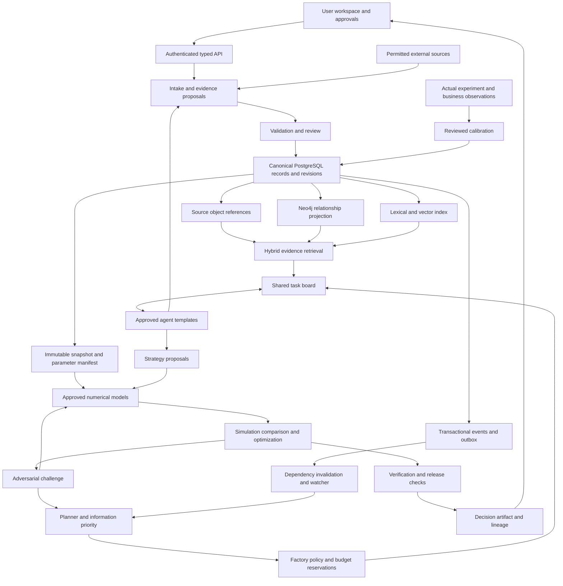
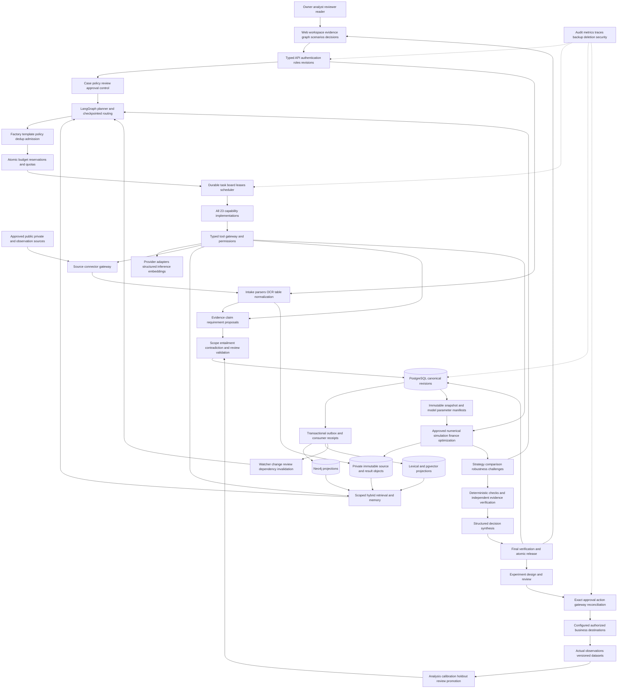
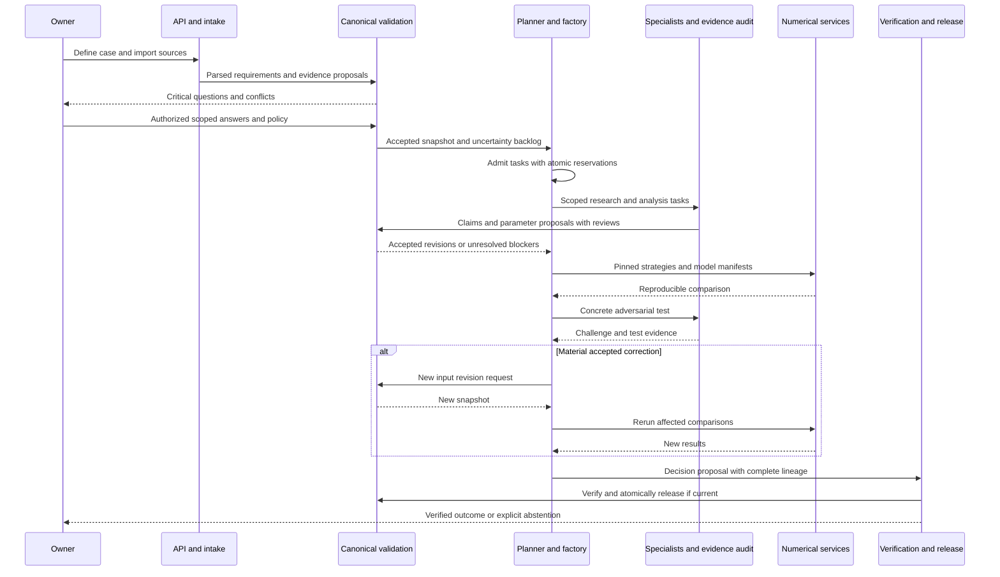
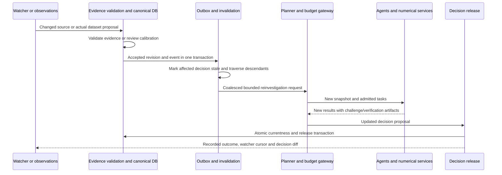
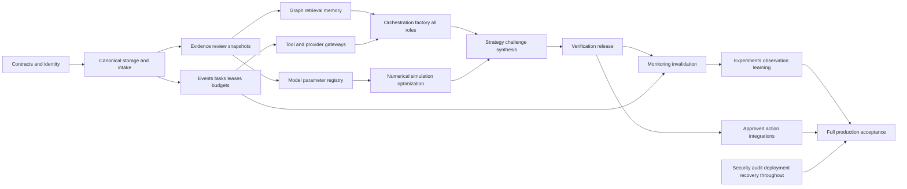

# Software Requirements Specification

Version 1.0 · 24 October 2026 · Proposed implementation baseline

This document specifies required system behavior and component boundaries for the [PRD](PRD.md). The [agent catalog](AGENT_SPECIFICATIONS.md) refines capability behavior. [Acceptance criteria](TRACEABILITY_AND_ACCEPTANCE.md) define verification evidence. None of these artifacts claims that an application or empirical market model already exists.

## SRS-001 Requirement authority and terminology

Scope: ALL. Every implementation change shall identify the requirement IDs it implements. Requirements may not be silently weakened to fit a library, provider, or deadline. A conflicting requirement or owner-critical unknown must produce a recorded decision request. Ordinary reversible implementation choices that preserve these contracts can be made without asking the user repeatedly.

Use `tenant` for the data/security boundary, `organization` for a modeled business, `case` for a decision problem, `investigation` for one bounded execution, `task` for a unit of work, `agent instance` for an admitted role execution, `artifact` for immutable versioned output, `claim` for an assertion, `observation` for recorded measurements, `assumption` for an explicit unmeasured input, and `scenario` for a hypothetical model configuration.

`KNOWN` means directly recorded and accepted in scope, not infallible truth. `INFERRED` requires a derivation. `ASSUMED` requires explicit labeling and permitted use. `UNKNOWN` has no selected value. `CONTRADICTED` has unresolved incompatible assertions. Epistemic state, evidence-review state, workflow state, and real/fixture origin are separate dimensions.

## SRS-002 Release scope and capability declaration

Scope: ALL. Every capability shall declare `AVAILABLE`, `DISABLED`, `UNCONFIGURED`, `UNSUPPORTED`, or `DEGRADED`, with a reason. An endpoint or UI action must return the appropriate state rather than fake success. Simulation services may run in fixture mode; LLM agents may not be represented as live when using scripted replay.

All requirements in this SRS apply to the complete system. Implementation stages express dependency order only. Every role and full-system capability needs implementation and acceptance evidence; tenant-specific activation remains governed by configured permissions and available data. Local test profiles do not replace production requirements.

A capability is implemented only when its actual input, validation, execution, persistence, user-visible output, and failure path work. A mock connector, static chart, or prompt-only agent must retain its fixture/stub status.

## SRS-003 Architecture and domain packages

Scope: ALL. The system shall separate experience/API, orchestration, evidence/knowledge, numerical modeling, decision/review, and observation/learning. These are logical modules, not a requirement for separate microservices.

The proposed baseline is React/Next.js for the client, FastAPI for commands/queries, LangGraph for bounded cyclic work, PostgreSQL for canonical records/events/jobs/checkpoints, pgvector and PostgreSQL lexical search for text retrieval, Neo4j for relationship projections, and an object-storage abstraction with immutable local files for development and versioned private object storage for production. NumPy/SciPy or equivalent tested numerical libraries implement models. A provider adapter isolates LLM/embedding calls. Version selection must be verified and pinned during implementation; no unverified latest-version assumption is part of this specification.

A domain package shall define supported decision types, entity extensions, input/output schemas, metric definitions, model IDs, valid intervention ranges, source authority rules, materiality rules, and validation fixtures. It may not execute uploaded arbitrary code. Unsupported domains must return an explanation and allow generic evidence intake without pretending to simulate them.

Agent-generated proposals can enter the validation path; they cannot bypass it to change accepted records. Runtime cycles do not imply cyclic immutable provenance: each iteration creates new artifact revisions.

## SRS-004 Identity and authorization

Scope: ALL. API and tool services shall derive tenant and actor identity from authenticated server context. Model-provided IDs are lookup inputs, not authority. Cross-tenant references must be rejected without revealing the other tenant's data. All object references, graph paths, caches, embeddings, traces, and signed downloads must enforce the same scope.

Roles are owner, analyst, domain reviewer, research operator, administrator, and reader, with explicit scopes from PRD section 3. Approval privileges shall be distinct from operational administration. A development-only profile may use one local owner session bound to loopback access and an unpredictable session token; it must still reject arbitrary untrusted origins and unauthenticated mutations. The full production system requires authenticated sessions, role assignment, revocation and tenant isolation.

Production PostgreSQL access shall use non-owner, non-superuser application roles with appropriate row-level policies. Row-level security is not sufficient by itself; owners and certain privileged roles can bypass it. Graph/object access must be independently enforced. [PostgreSQL row security](https://www.postgresql.org/docs/current/ddl-rowsecurity.html)

## SRS-005 File and structured-data intake

Scope: ALL. Intake shall validate actual media type, file size, page/row limits, parser resource bounds, tenant access, and declared data class. Required formats are UTF-8 text/Markdown, CSV, DOCX, XLSX, PPTX, text-bearing PDF and scanned PDF/image OCR. Parsers shall preserve tables, sheet/slide/page anchors, merged-cell semantics and extraction uncertainty. Macros and embedded executables shall never run. Unsupported or encrypted variants return explicit errors; formula cells preserve formula and cached value without claiming recalculation unless an approved calculation engine actually ran.

Store original bytes by cryptographic content hash under an immutable object ID. A repeated file can reuse stored bytes within permitted boundaries while retaining submission metadata. Do not leak cross-tenant hash existence. Parsing failures retain the upload status and diagnostics without creating accepted claims.

Intake returns a document ID and asynchronous job ID. The upload is not considered ingested until the parser and validation stages report their outcomes. Oversized or malformed files return an actionable error; partial tables must be marked partial. File contents are untrusted data and cannot provide runtime instructions.

## SRS-006 Parsing and source anchors

Scope: ALL. Parsers shall retain document version, page or row/cell location, section heading where available, exact extracted text, and extraction quality. OCR output must identify its OCR/parser version and ambiguity. Numeric columns must preserve headers, unit notes, currency, and effective periods.

An evidence locator is a typed object: `TEXT_LINES` with start/end and optional paragraph; `DOCUMENT_BLOCK` with paragraph/table/block ID and offsets for DOCX; `PDF_PAGE` with page and optional bounding box; `TABLE_CELLS` with table/sheet and cell/range identifiers; `SLIDE_SHAPE` with slide number, shape ID and text offsets for PPTX; `IMAGE_REGION` with image dimensions, bounding box and OCR-text reference; or `WEB_BLOCK` with captured block ID and character offsets. Offsets refer to the immutable parsed version, not a mutable live page. Locators must resolve in the source viewer or return `SOURCE_UNAVAILABLE` with retained provenance. Table anchors preserve merged-cell coverage; slide and document blocks preserve reading-order uncertainty. Coordinate conventions and zero/one-based numbering are explicit in the locator schema and source viewer, with round-trip tests.

An extractor may summarize surrounding context but cannot replace the quoted support span with its own wording. Raw content retention follows the data policy; rights-limited excerpts and hashes may replace full captured pages when required.

## SRS-007 Requirements extraction

Scope: ALL. Extract every field group listed in PRD-01 into typed values with units, scope, period, evidence references, epistemic state, review state, and revision. A source saying “budget 10 lakh” must be parsed as a magnitude in its stated currency; missing currency cannot be guessed from the user's location.

A field record shall include `field_key`, `value`, `value_type`, `unit`, `currency`, `tax_basis`, `scope`, `valid_interval`, `epistemic_state`, `verification_state`, `evidence_refs`, `derivation_refs`, `competing_claim_refs`, and `blocking`. Extraction confidence concerns parsing, not business truth. Unknown fields use null and a reason, not zero or an empty string.

User corrections create new assertions or explicit assumptions with actor provenance. A corrected extraction retains the previous version and its source link. Unverified company-reported facts may be accepted for case use with a label that they are company-reported, without claiming independent verification.

## SRS-008 Missing information and blockers

Scope: ALL. Each domain model shall define required inputs and allowed missing-input behavior. The planner shall rank gaps by feasibility impact, sensitivity, and whether research or the owner can resolve them. Internal cash, risk tolerance, and forbidden actions default to owner questions; public competitor terms can become research tasks.

The question artifact shall identify the field, why it matters, permitted answer types, affected decision/model, and whether an assumption range is permissible. The user can answer, explicitly authorize a scenario assumption, narrow the case, or decline. Declining a required input produces conditional output or abstention according to the model contract.

The system may continue independent work while waiting, but cannot run dependent definitive comparisons. Elapsed time, a selected default, or dismissal is not an answer or approval. Resume semantics are specified in SRS-027.

## SRS-009 Contradictions and identity ambiguity

Scope: ALL. Compare assertions only after aligning entity identity, SKU/offer version, geography, population, unit, tax basis, channel, and valid interval. Different dates or scopes can explain apparent disagreement. Two unresolved values on the same scoped predicate shall remain separately addressable and mark the selected field CONTRADICTED.

Entity resolution shall use canonical IDs and declared identity evidence. Ambiguous names produce candidate matches rather than automatic merges. An authorized merge/split creates an auditable revision and invalidates affected projections and outputs.

Conflict resolution must reference evidence or an authorized owner decision and cannot simply select the latest agent answer. A critical contradiction blocks release unless the output explicitly compares the competing scenarios and does not claim a resolved fact. The owner may choose a planning assumption without erasing the disagreement.

## SRS-010 Human review and materiality

Scope: ALL. Materiality means an item can change action feasibility, selected strategy, the agreed objective beyond its tolerance, required capital, a critical risk condition, or a statement necessary to justify the decision. A domain policy specifies thresholds and always-material categories. If policy is absent, treat used constraints, numerical inputs, and recommendation-supporting claims as material.

The server shall distinguish accepting a fact, authorizing an assumption for a scenario, approving an investigation budget, accepting an internal recommendation, and authorizing an external action. These are different approval types. Approvals bind actor, artifact revision/hash, scope, permitted amount if any, expiry, and revocation status.

A material artifact revision invalidates its prior action approval. The system may propose a new review request, but cannot copy consent to the revised action. Model-generated approval text has no authorization effect.

## SRS-011 Evidence admissibility and claims

Scope: ALL. A material claim shall include an exact subject/predicate/value or proposition, scope, time, source spans or derivation, epistemic state, verification state, and origin. Claim review states are `PROPOSED`, `ACCEPTED`, `REJECTED`, `NEEDS_REVIEW`, and `WITHDRAWN`; contradictory relationships are retained separately.

Acceptance checks shall verify source existence/access, locator validity, claim entailment, context, date/scope compatibility, and whether the asserted precision is supported. An evidence reviewer returns a structured review; a deterministic validation service enforces acceptance policy and commits the revision. A reviewer cannot accept its own unsupported source assertion solely by repeating it.

Evidence about popularity, sentiment, or market growth cannot directly become a conversion coefficient or elasticity. Numeric parameter promotion requires the measurement/estimator/assumption rules in SRS-029. Source withdrawal creates a new audit event and immediately makes affected released decisions stale or unavailable according to policy.

## SRS-012 Trust and freshness

Scope: ALL. Trust records shall store claim-specific authority, authenticity checks, directness, entailment outcome, extraction quality, applicable dates, and independent-origin status. Do not present these dimensions as a calibrated probability of truth without a validated mapping.

Publication, retrieval, effective, and recorded times are distinct. Unknown publication dates remain null. Freshness heuristics may influence retrieval ranking; they cannot override legal effective status or transform an old valid historical observation into falsehood.

Every source has `access_status`, source type, publisher/owner when known, URI or document reference, capture hash, and retention classification. A broken source must not be silently replaced by the language model's memory. Cached evidence displays its actual capture time. Search snippets may support discovery only, unless a domain policy explicitly allows a low-stakes snippet-only assertion marked accordingly; no material model input may rely on that exception.

## SRS-013 Source origins and deduplication

Scope: ALL. Identify exact and near duplicates, syndication, shared primary documents, ownership, and explicit citation chains. Store `OriginCluster` records and membership rationale. Independent-origin count is not URL count.

Duplicate material may remain searchable but must not increase corroboration, empirical sample size, or posterior strength. Uncertain shared origin must be represented as uncertain, not automatically independent. Data-derived estimates must handle repeated respondents/documents according to their observation model.

Changing source-cluster membership triggers reassessment of affected evidence-quality summaries and any statistical model that actually used independence weights. Clustering itself is not proof of manipulation. A source can be useful despite being a copy if its true origin is clearly represented.

## SRS-014 Bias, sentiment, and trend coverage

Scope: ALL, including comprehensive specialist evaluation. Build coverage by source origin, geography, language, collection channel, date, and measured/consented customer attributes. Unknown demographics stay unknown. Compare evidence coverage with the decision's population definition.

Sentiment outputs shall identify aspect, label, language, ambiguity, sample denominator, source cluster, and classifier version. Topic and trend outputs shall identify collection windows and volume normalization. A larger crawl cannot be described as stronger demand without a supporting observation model.

Confirmation-bias checks require a disconfirming search or an explicit reason it is unavailable. Selection, survivorship, geographic, demographic, and sampling bias checks return limitations and proposed robustness tests. Manipulation heuristics return `SUSPECTED` with reasons, never an unsupported fraud determination. Weighting needs a documented sampling/population basis and effective-sample-size reporting; it cannot correct missing groups by invention.

## SRS-015 Temporal semantics and snapshots

Scope: ALL. Assertions shall distinguish a half-open valid interval `[valid_from, valid_to)` from `recorded_at`. Null endpoints mean unknown/unbounded as explicitly typed, not the current date. The canonical log shall preserve when an assertion was first known and when it was corrected or withdrawn.

A historical as-known query excludes records first recorded after the specified knowledge cutoff even if their valid interval refers to earlier dates. A snapshot manifest pins all accepted assertion/constraint/parameter/model references used for a run. It includes a content hash, schema version, tenant/case, cutoff, and creation time.

Snapshots are immutable. A new material fact creates a new snapshot and a new investigation or explicit rebase boundary. A simulation cannot mix old and new parameter revisions. New evidence may cancel a run for an urgent hard blocker, but otherwise the old run may finish against its old snapshot and be clearly marked stale for current use.

## SRS-016 Canonical data model and persistence

Scope: ALL. PostgreSQL shall own canonical domain records, revisions, task status, budgets, approvals, and events. Files own immutable original bytes referenced by hash. Neo4j and vector/search indexes are rebuildable projections. Agents must not independently write equivalent accepted facts to all three stores.

Identifiers are opaque UUID strings; human fixture labels are separate aliases. An `ArtifactRef` contains `kind`, `id`, and positive integer `revision`. Cross-table foreign keys must preserve tenant scope. Monetary records use decimal values or integer minor units with currency; computed statistical arrays use finite floating-point values with declared tolerance. Null and not-applicable are explicit states.

| Record family | Required records and important fields |
|---|---|
| Ownership | tenants, users, memberships, organizations, cases; owner, role scope, case objective/horizon/policy |
| Sources | sources, documents, document_versions, evidence_spans; URI, hash, parser, locators, dates, classification |
| Assertions | entities, aliases, claim_revisions, claim_evidence, claim_relations, review_records; typed facts, scopes, statuses, reviewers |
| Requirements | requirement_revisions, constraint_revisions, assumption_revisions; provenance, hard/soft, authorized uses |
| Evidence quality | origin_clusters, cluster_members, coverage_reports, trust_reviews; methods, confidence labels, revision |
| Knowledge versions | world_snapshots, snapshot_members, projection_checkpoints; canonical cutoff and projection watermarks |
| Modeling | parameter_revisions, parameter_dependencies, model_versions, model_cards, calibration_records; schema, estimator, data refs, validity |
| Analysis | strategy_revisions, scenarios, simulation_runs, metric_records, comparisons, optimization_results; action specs, seed, manifest, outputs |
| Decisions | hypotheses, challenges, challenge_resolutions, verification_reports, decision_versions, artifact_dependencies |
| Execution | investigations, task_dependencies, tasks, agent_templates, agent_instances, tool_calls, checkpoints; leases, attempts, replay keys |
| Control | policy_versions, budgets, reservations, approvals, questions, answers; scopes, atomic usage, expiry |
| Events | events, outbox, consumer_receipts, dead_letters, subscription_rules; aggregate sequence, causation, processing status |
| Learning | experiments, datasets, observations, outcome_reviews; real/fixture mode, intervention, population, measured outcome |
| Retrieval | chunks, embeddings, lexical indexes, evidence_packs, retrieval_logs; source ref, embedding revision, query/filter metadata |
| Operations | trace_spans, audit_records, provider_capabilities, retention_tombstones; redaction, version, access |

Schema migrations shall add tenant-scoped referential checks, event/command idempotency uniqueness, active task fingerprint uniqueness, aggregate revision guards, and indexes for both directions of dependencies. Budget accounts cannot become negative through unchecked concurrent updates.

A generalized JSONB payload is permissible for versioned domain extensions, but not a replacement for required references, types, authorization fields, or invariants. Arbitrary executable expressions in JSON are prohibited. An immutable audit requirement does not override lawful deletion/retention policy; SRS-059 defines tombstone behavior.

## SRS-017 Graph schema and projections

Scope: ALL. Maintain three distinct graph meanings: business relationships, approved causal/model assumptions, and immutable artifact dependencies. A business edge does not establish causation.

Business entities include Company, Product, Service, Feature, Offer, PriceObservation, CustomerSegment, AggregateCohort, Competitor, Supplier, Channel, Capability, Resource, BrandPromise, Portfolio, Market, Geography, Regulation, Policy, EconomicSeries, and typed Events. Intelligence entities include Claim, EvidenceSpan, DocumentVersion, Source, OriginCluster, Hypothesis, Risk, and Opportunity. Decision entities include Assumption, ParameterRevision, ModelVersion, StrategyRevision, Scenario, SimulationRun, DecisionVersion, Experiment, AgentTemplate, and AgentInstance.

Relations include OFFERS, SERVES, COMPETES_WITH, SUBSTITUTES_FOR, SUPPLIES, DISTRIBUTED_VIA, REQUIRES, LIMITED_BY, SUBJECT_TO, OPERATES_IN, SUPPORTED_BY, CHALLENGED_BY, EXTRACTED_FROM, DERIVED_FROM, SUPERSEDES, USES_PARAMETER, USES_MODEL, EVALUATES, RECOMMENDS, and DEPENDS_ON. Material business edges reference the canonical assertion revision that establishes them.

Projectors consume canonical events idempotently and expose watermarks. Queries must request an appropriate snapshot/cutoff and reject or disclose lag. Projection failure cannot change the canonical truth. Projection rebuild must be possible from retained canonical records and permitted source references.

## SRS-018 Hybrid retrieval contract

Scope: ALL. `evidence.search` accepts a scoped question, snapshot, relevant entity IDs, time/geography/population filters, purpose, and result budget. Authorization scope is injected by the gateway. The service retrieves exact relational facts, lexical candidates, semantic candidates, and bounded graph context, then resolves original source spans.

Proposed bounded retrieval profile: 30 lexical candidates, 30 vector candidates, two graph hops, at most 100 expanded nodes, and 12 selected spans. These limits are configuration values; they are not accuracy guarantees. Reciprocal rank fusion can combine ranks without adding incomparable raw scores. PostgreSQL lexical search must not be labeled BM25 unless such scoring is actually implemented.

Every evidence pack includes query/filter metadata, snapshot/watermarks, selected spans/claims, contradiction refs, origin clusters, discarded/failed source summary, and coverage gaps. Reserve contradiction/independent-source capacity when available. A retrieval miss is not evidence of absence.

Model-generated SQL/Cypher must not execute directly. Approved parameterized query templates bound predicates, traversal, rows, time, and tenant. Unauthorized results must be filtered before retrieval scoring and rechecked when opening the evidence viewer.

## SRS-019 Memory contracts

Scope: ALL. Working memory stores bounded execution context and references. Semantic memory stores accepted assertions. Episodic memory stores investigations/decisions/failures. Procedural memory stores approved templates/models/policies. Experimental memory stores measured studies and calibration history. User preferences are explicitly configured tenant/case settings.

Memory summaries must reference underlying revisions and retain material uncertainty. An assumption cannot become KNOWN because it appeared in several summaries. A simulation output cannot become a real observation. A failed search is recorded with its actual scope and budget rather than as a universal negative fact.

Staleness and source withdrawal must propagate to dependent memories and retrieval. Cross-case reuse must check tenant, permissions, geography, dates, population, and model validity. A previous result can initialize a hypothesis, but must not bypass current-case validation.

## SRS-020 Events and delivery semantics

Scope: ALL. Event envelopes include `event_id`, `schema_version`, `tenant_id`, `aggregate_id`, `aggregate_revision`, `event_type`, `occurred_at`, `recorded_at`, `correlation_id`, `causation_id`, actor, input snapshot if applicable, and typed artifact payload references.

Required event families include document ingestion/failure, requirement proposal/approval, claim acceptance/dispute/withdrawal, parameter revision, research request, agent admission/rejection, task completion/failure, simulation completion/failure, challenge creation/resolution, verification rejection, decision release/staleness/supersession, experiment observation, and resource exhaustion.

Commit a canonical state revision and its outbox event in one database transaction. Consumers assume at-least-once delivery and use unique `(consumer_id,event_id)` receipts. Enforce per-aggregate revision ordering where correctness depends on order; buffer or rebuild on gaps. Global wall-clock ordering is not guaranteed.

PostgreSQL notifications may wake workers, but durable event and job rows remain authoritative. Notifications are a signaling mechanism and do not replace the retained event log. [PostgreSQL NOTIFY](https://www.postgresql.org/docs/current/sql-notify.html)

## SRS-021 Durable tasks and leases

Scope: ALL. Task states are `PROPOSED`, `QUEUED`, `RUNNING`, `WAITING_DEPENDENCY`, `WAITING_INPUT`, `RETRY_PENDING`, `SUCCEEDED`, `INCONCLUSIVE`, `FAILED`, `CANCELLED`, and `EXPIRED`. Terminal states cannot be reopened in place; a retry beyond the admitted attempt policy requires a new task linked to the old one.

Workers atomically claim ready tasks with a lease, heartbeat, attempt ID, and fencing token. Only the current lease/fencing token may commit the task result. A delayed prior worker cannot overwrite a recovered attempt. Waiting tasks release worker slots. Dependencies must have acceptable terminal outputs before dispatch; failed prerequisites do not automatically count as satisfied.

Use fingerprint deduplication over case, snapshot, task type, normalized question/scope, requested output, and source filters. Distinct reasoning tasks may share retrieval artifacts without collapsing their separate review obligations. Cycles with no new accepted information create a loop diagnostic and termination/replanning event.

## SRS-022 Scheduler and bounded autonomy

Scope: ALL. The scheduler shall select ready tasks using decision impact, dependency readiness, deadline, available capacity, and cost policy. It must support concurrent independent work, directed requests between roles, and revisiting research/modeling after challenges. All work remains visible through the task board.

The planner proposes priorities; scheduler policy owns dispatch. A model cannot bypass queue fairness or increase concurrency. Cases also obey organization-level daily/rolling spend, active-case limits, and rerun cooldowns. One busy source cannot starve unrelated approved cases indefinitely.

Continuous operation consists of idle observation plus finite investigations. A polling schedule alone cannot initiate expensive research when no material accepted change or approved user request exists. Duplicate events and unchanged content hashes do not count as new information.

## SRS-023 Agent factory and lifecycle

Scope: ALL. The factory shall instantiate only approved versioned capability templates. Templates define purpose, accepted input/output contracts, tool allowlist, data scope, model capability class, prompt revision, step/time/token limits, evaluator, and stop conditions. Domain specialization supplies bounded context, not executable code or new privileges.

Admission requires a decision-relevant uncertainty, no equivalent active task, approved template, sufficient budget reservation, compatible permissions, depth/instance capacity, and time to execute. Record accept/reject reason and triggering task. Unknown capabilities return `CAPABILITY_UNAVAILABLE`; they are not invented on demand.

Instances have `REQUESTED`, `ADMITTED`, `RUNNING`, `WAITING`, `SUCCEEDED`, `INCONCLUSIVE`, `FAILED`, `CANCELLED`, or `EXPIRED` status. The scheduler maps instance completion to task state. Each child retains parent/task provenance and inherits an equal-or-narrower capability envelope. Depth is the number of semantic delegations; LangGraph node revisits do not reset or increase it arbitrarily.

## SRS-024 Budgets and termination

Scope: ALL. Enforce organization, case, investigation, and task budgets for currency, input/output tokens, model calls, tool actions, active workers, total admitted instances, wall-clock deadline, and delegation depth. Zero currency authorization means no billable external calls; it does not mean unlimited use. Provider credentials alone do not authorize spending.

Proposed small-investigation profile for tests, enabled only within the owner's envelope: four active workers, eight admitted instances per investigation, depth two, six tool actions and 90 seconds per specialist, 30 model calls, 60,000 aggregate input-plus-output tokens, and six minutes active investigation time. The earliest applicable limit wins. These are test-profile ceilings, not full-system capacity limits or performance promises. Production investigations use explicitly configured larger envelopes where justified; global hard limits remain mandatory. Model input must be bounded before dispatch so output caps and input estimates can reserve a conservative maximum.

Reservations update atomic ledger rows before calls. Completion reconciles actual use; unknown billing status keeps the reservation pending until reconciliation rather than refunding immediately. Retries, evaluator calls, searches, and schema-repair calls consume budget. Cancellation stops new dispatch and preserves reservation for in-flight provider work.

Valid stop reasons include `CONVERGED`, `BUDGET_EXHAUSTED`, `TIME_EXHAUSTED`, `NEEDS_INPUT`, `NO_FEASIBLE_ACTION`, `MODEL_NOT_IDENTIFIED`, `SOURCE_UNAVAILABLE`, `CANCELLED`, and `SYSTEM_FAILURE`. The run's lifecycle state and reason must agree; exhaustion cannot imply successful convergence.

## SRS-025 Agent communication protocol

Scope: ALL. Agents communicate through typed requests and immutable artifacts: ResearchRequest, EvidenceProposal, Hypothesis, ParameterProposal, StrategyProposal, SimulationRequest, Challenge, ExperimentProposal, VerificationReport, and DecisionProposal. Each task includes identity/snapshot, input refs, output type, completion criterion, assigned capability, parent/dependencies, deadline, and budget reservation.

The common result envelope includes task/instance identity, input snapshot, artifact refs, claim/evidence/assumption refs, unresolved issues, requested task proposals, concise rationale, status, and stop reason. It must distinguish new proposals from accepted facts. Requested tasks pass factory admission; a result's `requested_tasks` array does not itself spawn workers.

Never use one mutable cross-agent chat transcript as the canonical world state. Context assembly uses required refs and bounded evidence packs. Agent disagreement creates challenge/conflict artifacts. Only authorized validation services commit accepted domain changes, and only the decision release service marks a decision current.

## SRS-026 LangGraph execution state

Scope: ALL for LLM orchestration. Graph state shall contain IDs/revisions for case, investigation, policy, snapshot, tasks, evidence packs, claims, parameters, candidates, simulations, challenges, pending questions, budget account, trace, and terminal outcome. Large documents/draw arrays remain outside graph state.

State reducers union immutable reference sets or merge maps by stable IDs. Reducers must not perform financial ledger mutations, approve claims, or overwrite contested facts. Budget and canonical record transactions occur in dedicated services. Parallel branches return explicit proposals, with one release service deciding the current verified artifact.

Use durable checkpointing for restart and review, distinct from domain knowledge. LangGraph distinguishes checkpointers for thread state and stores for cross-thread data; the application still owns its knowledge semantics. [LangGraph persistence](https://docs.langchain.com/oss/python/langgraph/persistence)

Required routing capabilities are assess, plan, admit, dispatch, collect, validate, revise parameters, propose actions, simulate, challenge, verify, await input, and finalize. Conditional edges and dispatched specialist tasks enable cycles. A framework recursion limit is a final guard, not the semantic convergence rule. Pin framework versions and verify APIs against their official documentation rather than inventing constructor/method names.

## SRS-027 Human interrupts and resume

Scope: ALL. A required question persists as a review artifact and changes the investigation to `WAITING_FOR_INPUT`. Release worker leases while waiting. The original decision/snapshot is retained, and the answer endpoint must authorize the actor and bind the response to the exact question revision and checkpoint.

An answer affecting requirements creates a new approved revision and an explicit new/rebased snapshot before dependent work resumes. External source changes accumulated while waiting require a revalidation step; they must not silently join old inputs. An already-terminal run cannot be resumed; create a linked investigation.

LangGraph can persist an interrupt and resume with a matching thread/checkpoint, but the interrupted node can execute again from its beginning. Therefore side effects before an interrupt must be idempotent or moved to a separate committed step. [LangGraph interrupts](https://docs.langchain.com/oss/python/langgraph/interrupts)

The active time budget excludes human waiting only if configured; an absolute expiry still applies. Resuming after absolute expiry requires a new authorized envelope. A missing answer does not become approval after a timeout.

## SRS-028 Hypotheses and uncertainty backlog

Scope: ALL. A hypothesis shall state a scoped proposition, its expected decision consequence, evidence supporting/challenging it, a falsification criterion, test options, and status. Hypothesis states are `PROPOSED`, `TESTING`, `SUPPORTED_IN_SCOPE`, `REFUTED_IN_SCOPE`, and `UNRESOLVED`. Supported is not universally proven.

Each uncertainty item links to affected claims/parameters/constraints, plausible range or alternatives, decision sensitivity, research/experiment options, estimated effort, resolvability, and deadline. The planner can merge duplicate uncertainty items while retaining provenance and independent dissent.

Hypothesis acceptance cannot be inferred from an agent's confident prose. Tests return observations or model-conditional results with their own evidentiary status. Repeating the same simulation cannot increase empirical support for the hypothesis.

## SRS-029 Evidence-to-parameter promotion

Scope: ALL. Language models propose parameters; they do not directly set accepted simulator inputs. A ParameterProposal identifies the model/parameter key, value or distribution, units, currency where relevant, population, geography, channel, period, source claims, derivation, uncertainty interpretation, applicability limits, and origin. The parameter registry accepts it only after schema, unit, range, time, model-domain, evidence and review checks.

The admissible origins are measured observations, fitted estimates, published estimates applicable to the domain, explicit scenario assumptions, or expert-reviewed structural assumptions. A favorable quote, sentiment score, or competitor announcement cannot automatically become a conversion probability, elasticity, retention rate, or causal uplift. Mapping qualitative evidence to a quantitative value requires a named, evaluated transformation; otherwise the value remains an assumption or unknown.

Parameter states are PROPOSED, NEEDS_REVIEW, ACCEPTED, REJECTED and WITHDRAWN. Acceptance creates an immutable revision with reviewer/policy provenance. Material assumption ranges require the case's authorized assumption policy. A distribution must identify whether it represents parameter uncertainty, heterogeneity, process randomness or a scenario sweep. Uniform sampling over arbitrary bounds is not a calibrated posterior. Correlations, truncation and support constraints must be explicit. Null is not zero, and unsupported point estimates cannot be laundered through broad distributions.

## SRS-030 Domain and model registry

Scope: ALL. Each executable model has a versioned manifest: ID, domain, purpose, mathematical definition, input/output schemas, units, time step, supported actions, data requirements, assumptions, limits, implementation checksum, dependency versions, numerical tolerances, validation report and reviewer. Validation states are UNVALIDATED, SCENARIO_ONLY, RETROSPECTIVELY_VALIDATED, PROSPECTIVELY_VALIDATED and RETIRED. Validation is scoped to a population, outcome and period; it does not transfer automatically to a new geography or product.

The registry supports deterministic accounting, customer response, adoption/diffusion, demand, competitor response, supply/operations, cash-flow, retention/cohort and environmental-impact models where applicable. A domain package selects compatible components and explicitly defines their interfaces. Domain-specific plug-ins use reviewed application code; uploaded documents and agent-generated code cannot execute as model plug-ins.

Prediction, causal intervention and scenario exploration must have different declared capabilities. Model selection cannot be made solely by best fit on training data. Validation shall assess leakage, temporal holdout, missingness, relevant subgroup errors, baseline comparisons and drift. If no model meets the required evidence standard, the system offers declared conditional scenarios or abstains. Framework completion does not satisfy empirical model validation.

## SRS-031 Customer, segment and demand models

Scope: ALL. Customer representations distinguish aggregate segments, observed cohorts and synthetic archetypes. Segment definitions include population, inclusion criteria, sampling frame, weights, measurement dates and consent/data-use limits. Synthetic archetypes can generate hypotheses and objections but cannot contribute observations, sample size or measured conversion.

Supported demand mechanisms shall be explicit alternatives. A funnel model uses eligible reach, exposure, conversion and purchase quantity with overlap controls; a CAC model uses eligible acquisition spend divided by acquisition cost, bounded by market and operational constraints. Combining these requires a defined reconciliation model, not multiplying both as independent demand drivers. Changes in spend may change CAC; the applicable response curve must be declared.

Price response requires measured or explicitly assumed elasticity/choice functions, valid price ranges, substitutes, market size and competitor assumptions. Feature or positioning uplift requires identified data or scenario labeling. Sentiment is an input to research prioritization unless a validated demand mapping exists. Network effects, saturation, switching costs and repeat purchases must use explicit state transitions and avoid double-counting existing customers as new acquisition.

Retention uses eligible cohort denominators, censoring and observation windows. Lifetime value requires a justified horizon, discount rate, gross-versus-contribution definition and survival/retention assumptions; extrapolated lifetime value must be labeled. Durable one-off purchases may make churn/retention inapplicable. Segment aggregation must reconcile to totals and preserve uncertainty from small/biased samples.

## SRS-032 Market, portfolio and operational dynamics

Scope: ALL. The model shall represent competitors/substitutes, channels, suppliers, lead times, capacity, inventory, fulfillment, returns and relevant market shocks. Competitor reaction is a scenario or empirically estimated policy, not an asserted prediction of intent. Market events identify affected geography, products and valid dates.

For every period, enforce conservation: beginning inventory plus receipts minus fulfilled units minus explicit losses equals ending inventory. Fulfillment cannot exceed available units or capacity. Backorders, lost sales, substitution and cancellations require separate policies. Procurement lead time, minimum orders and payment timing feed both operations and cash. Capacity expansion has cost and delay; it is not instantaneous unless the scenario says so.

Multi-product and multi-geography cases share constrained capital, channels and capacity. Cannibalization, cross-sell, shared customer overlap, transfer prices, currency conversion and resource allocation must be represented when material. Do not optimize each product independently and assume the portfolio is feasible. FX/tax rates require dated sources or explicit assumptions; currency conversion is never silently inferred.

Macro, regulatory, political, technological and environmental shocks enter through named affected parameters, constraints or model alternatives with provenance. Correlated shocks require a joint model or declared stress combination. A general business relationship graph does not by itself specify numerical propagation.

## SRS-033 Financial computation and cash

Scope: ALL. All material financial results must come from executable, unit-tested numerical functions. The LLM can explain outputs but cannot replace the calculator. Models define currency, tax basis, periods, recognition basis, cost allocation and rounding. Monetary ledgers use exact decimal/minor-unit representation; simulation floating-point output is reconciled to the declared display/ledger rules.

For the single-product fixture only: unit contribution equals net selling price minus unit COGS minus variable fulfillment minus payment fee minus acquisition cost attributable to that sale. Profit equals fulfilled quantity times unit contribution minus period fixed costs. Break-even units equal ceiling(fixed costs / positive unit contribution); non-positive contribution has no finite break-even under that model. CAC cannot also be deducted as acquisition spend a second time. For repeat purchases, acquisition cost applies to newly acquired customers rather than every order unless explicitly modeled otherwise.

Revenue, gross margin, contribution, operating profit and cash must remain distinct. Returns/refunds, payment fees, tax remittance, inventory purchases, receivables, payables, capital expenditure and financing receive explicit timing. Inventory purchase cash outflow and recognized COGS are not both operating cash outflows for the same payment. A profitable strategy can breach liquidity constraints. Report minimum cash and funding requirement as well as profit.

Forecast horizons must be consistent; annual market estimates cannot be treated as monthly sales. Negative/zero denominators return defined unavailable or infeasible outcomes rather than NaN or infinite claims. Accounting reconciliations and domain-specific definitions are mandatory before financial results can support decision release.

## SRS-034 Pricing and commercial strategy

Scope: ALL. Pricing proposals shall include currency/tax basis, SKU or service tier, geography, channel, promotion period, discount policy, payment terms, positioning, target segment and costs. Constraints include floor/ceiling, brand promises, channel agreements, regulation, willingness-to-pay evidence, margin and liquidity limits where configured.

The system shall distinguish optimizing price on an estimated response curve from comparing hypothetical demand at several prices. Without identified price response it cannot declare an empirically optimal price. Bundles, subscriptions and multi-product price interactions require domain-supported models. Candidate generation includes viable status quo, defer or pilot actions with their actual cost/opportunity assumptions; zero-cost deferral is not universal.

An action is an immutable strategy vector. Changing price and channel simultaneously creates a strategy comparison, not evidence for the isolated causal effect of price. Proposal validation rejects forbidden strategies before simulation where possible and retains rejection explanations. Final selection considers uncertainty, downside and constraints rather than maximizing a language-model score.

## SRS-035 Reproducible uncertainty simulation

Scope: ALL. A SimulationRequest pins the snapshot, parameter manifest, model versions/checksums, strategies, horizon/time step, uncertainty method, seed, random generator version, draw count, numeric environment and output metrics. Results include feasibility masks, failures, summaries, draw-artifact hashes, runtime and complete provenance. Agent-generated narrative cannot supply the result array.

The engine shall support deterministic scenarios and Monte Carlo where the input distributions justify it. Separate outer parameter uncertainty from inner process randomness when both matter. Shared random streams across candidate actions are permitted to reduce comparison variance and must be documented. Correlated variables use an explicit joint sampler; independent draws are not the default when dependencies are known.

Probability of loss is conditional on the model and distributions. Scenario frequency is not a real-world success probability. Report quantile definitions, uncertainty bands and Monte Carlo error separately from parameter/model uncertainty. More draws reduce numerical sampling error; they do not create evidence or cure model misspecification. Invalid draws cannot be silently dropped to improve results; classify and report them, fail the run above a declared tolerance, and review distribution support.

A run must be reproducible within declared numerical tolerances under the pinned environment. Large batches use bounded worker pools and cancellation checkpoints. Common-cause shocks and competing model structures receive sensitivity/stress analysis. Default draw counts are configuration decisions justified by numerical error targets and budget, not a universal fixed number.

## SRS-036 Scenarios and causal counterfactuals

Scope: ALL. A ScenarioPatch declares the base snapshot, target keys, proposed values/distributions, unit, rationale, evidence or assumption references and semantic type: SENSITIVITY, STRUCTURAL_INTERVENTION or CAUSAL_COUNTERFACTUAL. Patches create child snapshots; they never mutate the factual base. Changes recompute only affected descendants when safe, preserving unaffected versions.

Sensitivity holds specified inputs fixed and changes selected values. Structural intervention modifies a declared equation/action under structural assumptions. A causal counterfactual additionally requires an approved causal model, identification assumptions, unit/population interpretation and the necessary inference procedure; retrospective individual counterfactuals need appropriate latent-state inference. A causal graph drawn by an LLM does not establish identification.

The UI shall state what was held constant, which downstream mechanisms responded, which were omitted, and the interpretation limit. Time-dependent effects, competitor reactions and capacity changes must follow declared equations, not implicit narrative propagation. Unsupported interventions return MODEL_NOT_IDENTIFIED or UNSUPPORTED with an explanation.

## SRS-037 Optimization, objectives and robustness

Scope: ALL. Each case defines a measurable objective, feasible actions, hard constraints, risk measures, horizon and tie/indifference tolerance. The optimization service can enumerate finite candidates or use an approved numerical algorithm for a supported continuous/mixed problem. It shall retain search bounds, termination reason, evaluations and any optimality gap the method genuinely supplies. A heuristic result must not claim global optimality.

Compare alternatives under consistent snapshots and stochastic draws where appropriate. Hard constraints cannot be converted into soft penalties without owner authorization. Return feasible/infeasible status before rank. Support expected value, downside quantiles, regret and risk constraints as explicitly selected. For upper-tail loss CVaR at level alpha, use a documented estimator consistent with minimizing eta + E[max(loss-eta,0)]/(1-alpha); define loss sign and finite-sample handling. Do not label a lower profit quantile CVaR.

Report ranking stability under plausible parameters/model alternatives and identify switching thresholds. If all actions are infeasible, return that result with the blocking constraints. Multiobjective cases show tradeoffs or an approved utility/weighting policy; the agent cannot invent preferences. Optimization over an unvalidated scenario model remains conditional scenario optimization.

## SRS-038 Adversarial falsification and dispute resolution

Scope: ALL. The challenger receives the leading decision, strongest evidence, sensitivity results, constraints and uncertainty backlog. It must produce concrete failure propositions with affected artifact refs, severity/materiality, testable alternatives, proposed test and reversal criteria. Generic criticism is insufficient; fabricating contrary evidence is prohibited.

Challenges progress OPEN -> TESTING -> RESOLVED or UNRESOLVED, with REJECTED for invalid/duplicate challenges and SUPERSEDED when replaced. Resolution includes the test result and reviewer/policy decision; the challenged agent cannot dismiss a material objection merely by restating its rationale. Accepted corrections revise the relevant inputs and invalidate dependent computations. Unresolved material challenges remain visible and may block definitive release.

At least one challenge pass is required for material action recommendations. High-stakes case policy can require a domain reviewer independent of the proposer. Same-provider role separation alone is not statistical independence. Tests shall seed misleading supportive evidence and check whether contrary evidence is actually considered.

## SRS-039 Value of information and bounded adaptation

Scope: ALL. The planner shall connect research proposals to uncertain inputs and possible decision changes. Where a coherent probability/utility model exists, expected value of sample information equals expected optimal utility after a possible observation minus current optimal expected utility; net value also subtracts research cost, delay and other defined burdens. The possible observation needs a sampling/likelihood model. The system must not fabricate a numeric EVSI from qualitative confidence.

When exact/approximate VOI is unsupported, use an explicitly labeled priority heuristic based on decision sensitivity, plausible reversal, resolvability, independence of new information, effort and urgency. Scales/weights are policy settings. Perfect-information value may bound the value of resolving uncertainty under a valid model, but is not the expected payoff of a specific study.

Convergence requires no unresolved blocking constraints, verified material claims, a stable feasible action or justified abstention, no pending high-value admissible tasks, and stability over the configured completed comparison/challenge cycles. Policy defines objective/ranking tolerances and required cycles. Resource expiry is a distinct stop reason. A configured small-run example uses two completed stable cycles, not two identical LLM answers.

Self-optimization means evaluated improvements to routing, retrieval, caching, template selection and research allocation. Changes are proposed offline, tested on held-out cases, reviewed and versioned. The running system cannot rewrite policies, raise budgets, modify its evaluator, train on private data without permission, or alter production prompts/models unchecked. Rollback must be available for regressions.

## SRS-040 Verification pipeline

Scope: ALL. Before release, deterministic checks verify schemas, references, tenant/snapshot agreement, units, temporal applicability, numerical reconciliation, constraints, approvals, provenance closure, stale flags and budget/task completion. An independent evidence review checks that material prose is entailed by cited spans or clearly labeled inference/assumption. Numerical prose must match stored result fields within the declared rounding rule.

VerificationReport contains check IDs, PASS/FAIL/NOT_APPLICABLE outcomes, affected refs, diagnostics, reviewer/tool versions and blockers. NOT_APPLICABLE requires a reason. Mandatory checks cannot be skipped because a model requests it. A schema-valid but unsupported narrative fails grounding. A plausible number with no numerical artifact fails computation provenance.

Repairs create a new proposal and consume admitted budget. Repeated repair is bounded. If grounding remains unresolved, remove the unsupported assertion, qualify it explicitly, or release an abstention according to case policy. Verification cannot declare itself passed based only on another agent's success flag.

## SRS-041 Decision release and lifecycle

Scope: ALL. A DecisionProposal contains outcome type RECOMMEND, CONDITIONAL, DEFER, NO_FEASIBLE_ACTION or ABSTAIN; selected/comparison strategy refs; objective/constraints; results; material claims and assumptions; unresolved issues; challenges; confidence dimensions; reversal conditions; experiment recommendations; and stop reason. RECOMMEND requires all relevant hard gates; CONDITIONAL must prominently show the conditions and cannot authorize external execution automatically.

Decision artifact states are DRAFT, IN_REVIEW, VERIFIED, RELEASED, STALE, SUPERSEDED and WITHDRAWN. Only the release service transitions VERIFIED to RELEASED after checking current input validity and policy. A database transaction uses optimistic version checking and a uniqueness constraint for the current decision pointer per case; concurrent workers cannot both become current. A previous released decision becomes SUPERSEDED when replaced; stale historical content remains inspectable.

Investigation states are CREATED, RUNNING, WAITING_FOR_INPUT, COMPLETED, STOPPED, FAILED and CANCELLED. COMPLETED means a verified output was produced, including an explicitly verified abstention; it does not necessarily mean commercial confidence. STOPPED covers budget/time expiry with partial artifacts. Every terminal state carries an appropriate reason. Cases have OPEN, PAUSED, CLOSED and ARCHIVED lifecycle states; pausing prevents new investigation dispatch but preserves records.

The final synthesis agent only proposes text/structured decisions. It cannot mark verification passed, clear challenges, override cash constraints or commit the current pointer. Releasing a recommendation is distinct from approving business action execution.

## SRS-042 End-to-end provenance

Scope: ALL. A material result must traverse decision -> verification -> comparison/simulation -> strategy/model/parameter snapshot -> derivation/assumption -> claim -> evidence span -> source version. Direct factual statements can use the shorter claim/evidence path. Every edge identifies dependency role and exact revision, with hashes for external binary artifacts.

Dependency edges between immutable revisions form a DAG. New iterations may refer to older outputs as context, but an artifact cannot depend on its future descendant. Summaries preserve reference links and cannot become independent corroborating sources. The UI shall distinguish observational support, assumptions, computations and critique edges.

If retention policy removes source text, retained lineage shall expose that evidence is no longer inspectable and downgrade current use accordingly. Provenance export includes manifests and permitted excerpts without exposing secrets, unrelated tenant data or private model reasoning. A provenance link is not itself proof of entailment; SRS-040 still applies.

## SRS-043 Watchers and continuous observation

Scope: ALL. Watcher definitions specify source/connector, approved scope, schedule/timezone, freshness expectation, allowed query budget, materiality policy, deduplication key and affected case families. Support external public intelligence, authorized private business datasets and actual experiment outcomes through connector adapters. The scheduler persists next-run time, lease, attempts and last successful source cursor.

A watcher detects content/version changes, reuses immutable captures when unchanged, and proposes changed evidence. Changes must pass the same evidence review as initial ingestion. A changed webpage alone is not an accepted fact. Rate limiting, access denial, source removal and parsing drift produce visible degraded status with backoff; repeated denial cannot trigger unauthorized alternate collection.

Idle monitoring does not continuously invoke LLMs. Cheap change detection and deterministic materiality filters precede budgeted analysis. Tenant/day/month and per-source quotas prevent many small runs bypassing caps. Notifications identify meaningful new decisions, blockers or failures; unchanged checks stay quiet under the configured policy. Notifications to external recipients require configured recipient authorization.

## SRS-044 Dependency invalidation and recomputation

Scope: ALL. Accepted revisions, withdrawals, expiry, model changes and scope changes emit versioned events. The invalidation service traverses dependency edges to mark affected parameters, snapshots, simulations and decisions stale. It records the triggering refs, rule and invalidation time. Unrelated cases and artifacts remain valid unless a shared dependency actually changed.

New evidence can invalidate a material claim even before a replacement is accepted if it makes the prior conclusion unsafe under the review policy. The current decision display must show STALE immediately after the invalidation transaction; asynchronous recomputation cannot preserve a false-current badge. Evidence under review appears as a pending challenge rather than silently replacing accepted inputs.

Recomputation creates a new bounded investigation pinned to a new snapshot, coalescing duplicate events without losing causes. Late/out-of-order events compare aggregate revisions and cannot regress current state. Cyclic cascades and event storms are controlled by deduplication, generation IDs, debounce policy and organization budgets, not by ignoring material changes. Rerun output includes the changed inputs and decision consequence.

## SRS-045 Experiment design and observations

Scope: ALL. An ExperimentProposal states the uncertainty/hypothesis, target population, intervention/control, allocation method, primary metric, guardrails, measurement window, estimand, analysis plan, sample-size/power assumptions where applicable, cost, consent/operational constraints, stop rules and decision threshold. If assumptions do not support a numeric sample size, request expert review or present a qualitative pilot without invented power claims.

Study types include permitted observational data collection, customer interviews, pricing tests, channel pilots and randomized experiments when appropriate. Nonrandomized designs must disclose confounding. Multiple testing, repeated peeking, attrition and interference require explicit analysis choices. An experiment plan is not evidence that participants were contacted or the experiment ran.

Experiment states are DRAFT, IN_REVIEW, APPROVED, RUNNING, PAUSED, COMPLETED, ABORTED and ANALYZED. External execution passes SRS-047 separately. Observation ingestion records dataset version, collection method, time, population, units, missingness, deduplication, consent scope and REAL/FIXTURE origin. Synthetic results cannot be imported into real experiment cohorts. Analysis output links the prespecified plan and any deviations.

## SRS-046 Learning, calibration and drift

Scope: ALL. Actual outcomes may propose updates to parameters/models only through a reviewed analysis pipeline. Evaluate on temporally appropriate holdout or prospective data and compare predictions made before outcomes were known. Historical re-runs must not leak corrected future knowledge into the original prediction snapshot.

Updates require compatible measurement and sampling models. For example, a Beta-binomial conversion update requires actual eligible trials and successes under its assumptions; quotes and synthetic personas do not add pseudo-observations. Weighting, hierarchical pooling and transfer across domains require named methods and applicability review. Detect shift in input distributions, coverage, outcome calibration and decision error; drift alarms alone do not authorize automatic retraining deployment.

Model promotion records candidate/baseline metrics, uncertainty, subgroup results, validation scope, reviewer, rollout and rollback plan. A declined model remains available for audit but cannot become active. Learning history separates changed evidence, changed estimates, changed structure and changed agent policy. Improvement claims require comparable datasets and budgets, not self-assigned model grades.

## SRS-047 External actions and approval enforcement

Scope: ALL. Build an action gateway for configured connectors that can send notifications, create approved experiment tasks, change external business records or initiate other explicitly supported actions. Every action type has a versioned schema, permissions, preconditions, risk classification, preview, idempotency contract and reconciliation method. Arbitrary shell commands, arbitrary HTTP destinations and unknown connector actions are not valid business actions.

Approval binds tenant, actor/reviewer, exact action payload hash, destination/recipients, resource limits, expiry, permitted attempts and artifact version. Investigation budget approval is not action approval. A new price, recipient, spend or payload revision invalidates the previous approval. Policy-authorized recurring actions must still have explicit scope, caps and revocation. The executor checks approval immediately before dispatch and records provider receipts without exposing secrets.

Action states are DRAFT, PENDING_APPROVAL, APPROVED, DISPATCHING, SUCCEEDED, FAILED, UNKNOWN, REVOKED and EXPIRED. A timeout after dispatch becomes UNKNOWN until reconciliation establishes outcome. Never blindly retry a non-idempotent action. Revocation cannot undo an action already accepted by an external service; compensating actions require their own policy. Report partial success and reconciliation failures visibly. All mutation connectors start disabled until configured and authorized.

## SRS-048 API contracts and error semantics

Scope: ALL. The application publishes versioned OpenAPI contracts for `/api/v1`. Mutating commands accept an `Idempotency-Key`; conflicting reuse with a different body returns 409. Updates require an expected revision/If-Match and return 409 on stale writes. Large jobs return 202 with job/artifact links; successful synchronous creation returns 201. Server-side identity sets tenant and actor regardless of client body.

| Route family | Required commands/queries | Principal contract |
|---|---|---|
| `/organizations`, `/cases` | Create, read, revise scope, pause, close, archive | Organization, Case, PolicyEnvelope; explicit revision |
| `/cases/{id}/sources` | Upload/register source, ingestion status, source versions | Upload receipt, parse diagnostics, immutable SourceVersion |
| `/cases/{id}/requirements` | Read proposed/accepted fields; propose correction | RequirementField with span/assumption references |
| `/reviews/{id}` | Read; submit scoped review response | Bound question/revision, authorized response |
| `/cases/{id}/knowledge` | Entity/claim/time queries; relationship views | Scoped paginated facts and paths, projection watermark |
| `/cases/{id}/evidence/search` | Query hybrid retrieval | EvidencePack with exact spans and coverage |
| `/cases/{id}/investigations` | Start/read/cancel; inspect task/event timeline | Investigation, budget reservation, snapshot |
| `/tasks/{id}` | Read task status/artifacts/diagnostics | Typed task with attempts and terminal reason |
| `/cases/{id}/strategies` | Propose/read revisions | Strategy vector and constraint review |
| `/cases/{id}/scenarios` | Create patch/read derived scenario | Base snapshot, typed patch, semantic type |
| `/cases/{id}/simulations` | Submit/cancel/read/comparison | SimulationRequest and immutable results |
| `/cases/{id}/decisions` | List/read verified history/current; request review | DecisionPackage, stale reason, lineage |
| `/artifacts/{id}/lineage` | Inspect bounded dependency traversal | Revisions/edge types and missing-source states |
| `/cases/{id}/watchers` | Configure/pause/status | Source scope, schedule, freshness and quotas |
| `/cases/{id}/experiments` | Propose/review/start via approved action/analyze | Experiment plan, observations, analysis revisions |
| `/observations/imports` | Import approved actual datasets/status | Dataset provenance and REAL/FIXTURE origin |
| `/actions`, `/approvals` | Preview/request approval/dispatch/reconcile/revoke | Hash-bound action and separate approval artifacts |
| `/admin/capabilities`, `/admin/policies` | Inspect/configure permitted capabilities | Role-scoped config without readable secrets |
| `/exports`, `/deletions` | Create/status scoped export or deletion request | Manifest, policy, job and audit outcome |
| `/events` | Authenticated SSE stream with cursor resume | Redacted event projections, not raw internal payloads |

Required stable error codes include VALIDATION_ERROR, UNAUTHORIZED, FORBIDDEN, NOT_FOUND, REVISION_CONFLICT, UNSUPPORTED_FORMAT, CAPABILITY_UNCONFIGURED, MISSING_REQUIRED_INPUT, EVIDENCE_REJECTED, STALE_SNAPSHOT, MODEL_NOT_IDENTIFIED, CONSTRAINT_VIOLATION, BUDGET_EXHAUSTED, RATE_LIMITED, SOURCE_UNAVAILABLE, PROVIDER_UNAVAILABLE and INTERNAL_ERROR. Error envelopes contain code, safe message, request/trace ID, retryability and structured field diagnostics; no stack traces or secrets. Use 400/422 for malformed/semantic input, 401/403 for access, 404 without cross-tenant existence leakage, 409 for state conflicts, 429 for quotas and 503 for unavailable dependencies.

List endpoints use bounded cursor pagination and deterministic ordering. Dates are UTC RFC3339 with timezone-aware input conversion; display uses the user's timezone. Downloads are scoped and time-limited. SSE reconnect replays only authorized events after the cursor, tolerates duplicates and exposes retention gaps requiring refresh. API clients cannot mutate accepted facts or decision state by directly setting status fields.

## SRS-049 Tool registry and MCP boundary

Scope: ALL. Every callable tool has a version, JSON input/output schemas, effect class, data scope, required capabilities, timeout, cost estimator, retry/idempotency policy, redaction rules and evaluator. Validation occurs before and after execution. Tool results are data; text returned by sources or tools cannot rewrite system instructions. MCP is an optional transport adapter over this registry, not a replacement for authorization or durable workflow.

| Tool | Effect and output | Admission/preconditions |
|---|---|---|
| `requirements.get` | Read scoped requirement manifest | Case access and snapshot |
| `knowledge.query` | Read approved query templates/paths | No arbitrary Cypher/SQL from models |
| `evidence.search` | Read hybrid EvidencePack | Scope/filter/result budget |
| `evidence.fetch` | External read and source capture | Approved connector/domain, fetch budget |
| `evidence.get_span` | Read exact source locator/context | Source rights and tenant access |
| `sources.cluster` | Propose origin/duplicate clusters | Versioned evidence set |
| `coverage.audit` | Read/calculated coverage report | Defined target population |
| `sentiment.classify` | Propose aspect/language classifications | Approved classifier and text scope |
| `claims.propose` | Write unaccepted claim proposal | Evidence/derivation references |
| `parameters.propose` | Write unaccepted parameter proposal | Model schema and uncertainty basis |
| `models.evaluate` | Deterministic model calculation/fitting | Approved model, data, limits |
| `finance.evaluate` | Deterministic financial result | Compatible accepted/scenario inputs |
| `scenario.patch` | Create hypothetical child snapshot | Allowed keys and intervention semantics |
| `simulation.run` | Enqueue bounded numerical run | Pinned manifest and compute reservation |
| `simulation.compare` | Read/calculated aligned comparison | Compatible result horizons/units |
| `optimization.rank` | Calculate feasible ranking/frontier | Approved objective/risk policy |
| `research.request` | Propose task; does not dispatch directly | Purpose, dependencies, completion test |
| `challenges.raise` | Write typed falsification challenge | Target refs and test/reversal criterion |
| `experiments.design` | Write experiment proposal | Hypothesis, estimand, plan and constraints |
| `review.request` | Create scoped review question | Exact artifact revision and reviewer scope |
| `tasks.list` | Read scoped task state | Bounded relevant investigation |
| `budgets.get` | Read remaining/reserved budget | No budget mutation privilege |
| `memory.retrieve` | Read scoped accepted memory | Validity/time filters and provenance |
| `memory.propose` | Propose reusable memory revision | Provenance and expiry/review policy |
| `verification.check` | Run named checks; create report | Registered check suite and input manifest |
| `decisions.propose` | Write draft structured decision | Result/claim/assumption references |
| `actions.preview` | Create non-executing action preview | Configured action schema and destination |

Privileged functions for task admission, budget reservation, claim acceptance, snapshot release, model promotion, action dispatch and decision release are internal services with distinct service identities. They are not tools exposed to general agents. An action preview cannot send anything.

MCP integrations must preserve structured outputs and schema contracts supported by the negotiated protocol version; version support is verified at implementation. Tool descriptions and annotations are not security enforcement. Remote MCP servers are explicitly configured and allowlisted, with scoped credentials, timeouts and result validation. [MCP tools specification](https://modelcontextprotocol.io/specification/2025-11-25/server/tools)

## SRS-050 Workflow automation and n8n

Scope: ALL for the integration boundary; n8n adoption is optional. Core agent reasoning, dependencies, budgets, state and release gates belong to the application. A workflow adapter can handle approved scheduled triggers, file transfer, notifications and external system coordination. It invokes typed API commands and receives durable job IDs rather than implementing a second hidden decision engine.

The system must work with its native scheduler without requiring the owner to manually build n8n flows. If n8n is selected, the implementation supplies versioned workflows, setup documentation, credentials references, webhook authentication, signature/replay checks where supported, idempotency keys, failure/retry routes and integration tests. Licensing, hosting and version compatibility must be checked before adoption; do not assume every deployment use is covered by an open-source license.

Duplicate deliveries from a workflow must not duplicate observations or actions. Workflow credentials are scoped independently. A workflow cannot bypass the application action gateway by possessing a destination API credential. Hidden workflow execution failures must surface through the case/operations UI with reconciliation status.

## SRS-051 Provider adapters and inference efficiency

Scope: ALL. Define adapters for structured generation, embeddings, optional reranking and optional classification. Each adapter reports provider/model/version, supported schemas/context limits, input/output usage, finish reason, latency, request ID and error class. Routing uses evaluated capability classes rather than one API per agent. Multiple roles may use the same provider/model; local inference is supported when it satisfies contracts and resources.

Use deterministic parsing/calculations before LLM calls, bounded evidence packs, exact-key caching for immutable inputs, incremental recomputation, batched independent classification where safe and lower-cost models for evaluated extraction tasks. Escalation to a stronger model requires remaining budget and an allowed route. Cache keys include tenant/security scope, model/prompt/schema versions and relevant input hashes; caching cannot leak another tenant's content.

Schema repair is bounded and charged to budget. Unsupported structured-output APIs use validated adapter strategies or explicit unavailability; never invent method names. Provider fallback requires compatible data permissions, model capability and evaluation status. Silent fallback to a provider outside approved data regions is forbidden. Usage pricing is a versioned configuration validated against actual service terms; no hardcoded claim of current pricing appears in this specification.

Sensitive evidence is minimized/redacted before dispatch according to data policy. Provider retention/training settings and contracts must be verified before confidential data use. Model availability, licensing and embedding dimensions are recorded. Changing embedding models creates a new projection version and reindex plan rather than mixing incompatible vectors.

## SRS-052 Privacy, tenancy and data governance

Scope: ALL. Data classification includes PUBLIC, INTERNAL, CONFIDENTIAL and RESTRICTED, with tenant-defined processing/retention rules. Access checks cover database rows, graph traversals, object URLs, search indexes, caches, model context, logs and exports. Service credentials use least privilege and cannot inherit arbitrary user authority from payload fields.

Personal/customer information must be minimized, purpose-bound and masked in default views. Collection must record authorized purpose and applicable consent/data-use restrictions; do not infer sensitive attributes from names or text. Training/reuse across tenants is disabled without explicit permission. Production data region, subprocessors and retention are owner decisions, not assumptions.

Export/deletion access is role-controlled and audited. Analytics use permitted aggregation with privacy thresholds where required. Security tests must include cross-tenant guessed IDs, semantic search contamination, shared-cache keys, graph traversal leakage, export URLs, SSE subscriptions and administrative boundaries. Administrator access to secrets or business content requires explicit policy, not an implicit superuser UI.

## SRS-053 Prompt injection and untrusted content

Scope: ALL. Uploaded files, websites, connector records, retrieved memories and tool output are untrusted evidence. The system separates policy/instructions from quoted source data, limits context to necessary spans and labels source origin. Embedded instructions requesting secrets, tool use, privilege changes or output manipulation must not be executed.

Instruction filtering alone is insufficient. Tool gateways enforce allowlists, scope, budgets and action approvals independently of model text. Agents cannot create arbitrary URLs/SQL/code execution or read local files outside their source permissions. Evidence can describe instructions as factual content without granting them authority. Suspicious source behavior is recorded without automatically discarding legitimate contrary evidence.

Acceptance includes injected documents that ask to change budgets, mark false claims accepted, send data to an attacker URL and conceal failures. The correct outcome is preserved policy and scoped source processing, with a safe diagnostic where useful. A successful injection must block release until the affected artifact lineage is reviewed.

## SRS-054 Application and connector security

Scope: ALL. Production requires TLS, secure session cookies or appropriately scoped tokens, CSRF/origin controls for browser mutations, session revocation, least-privilege service identities, secret storage, encrypted storage/backups according to deployment policy and access audit. Do not expose database, graph or worker control ports publicly.

External fetchers enforce scheme/domain rules, resolve/recheck destinations and redirects, block private/link-local/metadata addresses unless an explicitly configured internal connector authorizes them, and bound response size/time/decompression. Uploaded parsers and numerical workers run with resource isolation and no unnecessary network/host privileges. Archive traversal, malicious XML, macros, oversized files and formula injection in exports require tests.

Secrets are injected through secret-management mechanisms, never embedded in prompts, sources, logs or artifacts. Dependency/security scanning and license review are required before deployment. Vulnerability response must identify affected versions, remediation, rollback and notification policy. No claim of regulatory compliance or certification is made merely because these controls exist.

## SRS-055 Observability and audit

Scope: ALL. Correlate request, case, investigation, task, agent instance, provider request, tool call, snapshot and artifact IDs. Record timestamps, duration, usage/reservations, retry counts, version manifests, terminal reasons and safe diagnostics. Logs exclude credentials and minimize raw personal/source content; detailed evidence stays in authorized storage.

Dashboards expose queue age, active workers, failure/dead-letter rates, provider latency, budget reconciliation, connector freshness, projection lag, stale decisions, simulation invalid-draw rates and verification failures. Alert thresholds are configured per deployment. Audit records cover permissions, approvals, accepted facts, model promotion, action dispatch, exports and deletion; tamper-evident retention and access are required according to risk policy.

Agent traces contain tool requests, results/refs, concise decision rationale and state transitions. Private chain-of-thought is not a required artifact. Instrumentation failure cannot silently approve an external action or decision; fail closed where audit is mandatory and degrade read-only views explicitly.

## SRS-056 Evaluation and release evidence

Scope: ALL. Maintain versioned test datasets with known answer spans, seeded contradictions, missing fields, source-origin duplicates, numerical golden cases, injection cases and real-world evaluation datasets when authorized. Separate training/tuning from evaluation to avoid leakage. Human review rubrics must specify what qualifies as supported, materially omitted, misleading or correctly abstained.

Evaluate extraction completeness, exact anchor correctness, retrieval coverage including contrary evidence, claim entailment, parameter admissibility, numerical correctness, constraint compliance, decision stability, revision correctness, budget enforcement, connector failure handling, privacy and recovery. Report numerator/denominator and severity, not a composite quality number alone. Probabilistic outputs use appropriate calibration/scoring metrics only when actual labeled outcomes exist.

Compare against a spreadsheet/domain baseline, a simpler single-agent research baseline and ablations of graph retrieval, adversarial review and adaptive research under comparable data/budgets. The purpose is to verify added value, not guarantee the multi-agent system always wins. Any provider/template/model change reruns affected suites and regression cases. All mandatory acceptance tests in the traceability document must pass before full-system completion is claimed.

## SRS-057 Performance and capacity acceptance profiles

Scope: ALL. The following are proposed engineering targets, not measured results. Before claiming production readiness, record deployment hardware, versions, dataset, concurrency, test duration and cost. Owner changes to scale/SLOs require a specification revision rather than an undocumented assumption.

| Profile | Proposed workload | Acceptance target |
|---|---|---|
| Control API | 10 tenants, 20 concurrent interactive users, 100k claims and 1m dependency edges total | p95 cached/read control queries <=1 s, commands acknowledged <=2 s, excluding provider/large export work |
| Retrieval | Same profile, 100k indexed evidence chunks, two-hop bounded graph query | p95 evidence-pack retrieval <=3 s excluding external network/model reranker |
| Event revision | 10 accepted material change events/s for 5 min | p95 direct stale marking <=5 s; descendant invalidation <=30 s for tested graph size; no lost accepted event |
| Numerical fixture | 20 strategies x 10k draws x 90 periods, approved simple model | Proposed <=60 s on declared 8-vCPU/16-GB test host, with bounded memory and cancellation <=5 s between batches |
| Concurrent investigations | 20 active investigations, configured maximum 4 active workers each | No starvation beyond declared scheduler bound, no cap bypass; provider latency reported separately |
| Endurance | 24-hour mixed workload with injected restarts/rate limits | No leaked leases/reservations, unreconciled duplicate actions or unbounded queue growth |

Provider/source latency is observed and bounded by timeouts but cannot be promised as deterministic. A six-minute small-run profile is not a universal full-system completion time. Production capacity planning must include object storage, graph/vector growth, numerical compute and source/API quotas. If these targets fail, report the measured limitation and remediate or obtain an explicit revised target; do not label them achieved.

## SRS-058 Deployment, modules and dependencies

Scope: ALL. Deliver a reproducible local development environment and a production deployment profile with configuration validation, migrations, health/readiness checks, backups, rollback and operations runbooks. Keep logical modules independently testable; split services only when isolation/scaling justifies it. No Kubernetes, Redis, Kafka, separate vector database or workflow server is mandatory without a demonstrated need.

| Component | Baseline | Depends on | Owns / must not own |
|---|---|---|---|
| Web workspace | React/Next.js + TypeScript | API and authenticated session | Presentation and interaction; no authoritative budgets/calculations |
| API/control service | Python/FastAPI | Identity, PostgreSQL, object adapter | Commands, authorization, revisions, API schemas |
| Orchestration worker | Python/LangGraph | Task ledger, checkpoint store, tool registry | Routing and bounded proposals; no direct fact/decision approval |
| Canonical store | PostgreSQL | Durable private storage/backups | Facts, revisions, events, tasks, budgets, approvals |
| Retrieval projection | pgvector + PostgreSQL lexical search | Accepted source/chunk versions | Search candidates; not canonical facts |
| Graph projection | Neo4j | Canonical graph outbox | Business/causal/dependency traversal; rebuildable |
| Object storage | Private versioned object adapter; local development adapter | Auth, retention and hashing | Original bytes, parsed artifacts, simulation draws |
| Ingestion workers | Format-specific reviewed parsers/OCR | Object store, job queue, resource sandbox | Parse artifacts and anchors; no automatic truth acceptance |
| Numerical workers | NumPy/SciPy + approved domain code | Model/parameter manifests | Simulations, fits, accounting and optimization |
| Observation/invalidation | Native scheduler and durable jobs | Events, connectors, dependencies, budgets | Change detection, stale propagation, rerun requests |
| Provider adapters | Configured LLM/embedding/classifier endpoints or local runtime | Secret config, policy, budget ledger | Typed provider calls and usage receipts |
| Action adapters | Configured external services; optional MCP/n8n transport | Approval gateway and reconciliation | Approved effects only |
| Operations | Metrics/logs/traces, CI, backup service | All runtime components | Health/audit/recovery, not business approval |

Suggested repository boundaries are `apps/web`, `services/api`, `workers/orchestration`, `workers/ingestion`, `workers/numerical`, `packages/contracts`, `packages/domain_models`, `packages/agents`, `packages/connectors`, `packages/knowledge`, `infra`, `tests`, `evals` and `docs`. This is a proposed layout, not a claim that directories already exist. Shared schemas generate client types where practical; generated code is checked for compatibility.

Runtime versions, parser/OCR packages, numerical solver licenses, database extensions and deployment images must be pinned to tested compatible versions with lockfiles and an SBOM. Verify official APIs before coding. Required environment settings include database/graph/object addresses, secret references, authentication issuer/audience, allowed origins, model routes, source scopes, data region, retention, queue limits and budget policy. Startup fails on missing required production security configuration; it does not silently use development defaults.

Build dependency order: contracts/identity -> canonical storage/intake -> validation/snapshots -> retrieval/events/tasks -> tool/provider boundary -> orchestration/factory -> domain models/simulation -> strategies/challenges/release -> monitoring/invalidation -> experiments/learning/actions -> full production validation. Security, audit and tests accompany every stage. All stages remain required.

## SRS-059 Retention, export and deletion

Scope: ALL. Retention policies separately govern original sources, extracted text, observations, accepted claims, model inputs/results, logs, checkpoints and backups. Production durations, legal holds and jurisdiction are owner-configured; do not invent legal retention periods. Source rights may limit full-text storage while permitting metadata/excerpts.

Deletion enumerates canonical rows, object versions, vector/graph projections, caches, provider-retained copies where controllable, exports and backup expiry obligations. It revokes access promptly, records a tombstone/audit minimum allowed by policy and verifies downstream removal. Historical decisions referencing deleted support show unavailable/redacted evidence and lose current usability if material support is no longer permissible.

Exports include schema/version manifest, permitted evidence, calculations, decisions and lineage, with deterministic IDs and hashes for verification. Do not export credentials, other tenants or hidden model reasoning. Restore must reapply deletion tombstones so backups do not resurrect accessible deleted data. Export and deletion are asynchronous tracked operations with explicit partial failures.

## SRS-060 User interface, accessibility and honest status

Scope: ALL. Required screens are defined in the PRD. Each supports loading, empty, degraded, permission-denied, stale, conflict and failure states. LIVE/CACHED/FIXTURE origin is visible at relevant result and source levels. Conditional scenarios cannot share an unqualified forecast badge. Accessibility includes keyboard navigation, visible focus, semantic labels, contrast, accessible tables/text alternatives and non-color-only status indicators; verify against the project's selected current accessibility standard before claiming conformance.

Explain a blocked decision with the missing field, its consequence and available next action. A user can inspect exact evidence and numerical definitions without reading all traces. Scenario sliders display units and model-supported ranges; unsupported values cannot silently clamp without notice. Approval previews show actual recipient/action/spend and expiry. Cancellation feedback distinguishes stopping dispatch from already in-flight work.

The system must support timezone-aware dates, explicit currency formatting and exported numeric precision. Multilingual sources retain original text and identify translations with translator/model version and uncertainty. Translation does not create a new independent source. User-visible summaries must be generated from verified structured artifacts rather than independently inventing results.

## SRS-061 Reliability, transactions and recovery

Scope: ALL. Canonical writes and outbox events commit in the same transaction. Consumers use inbox receipts and idempotent handlers. At-least-once processing is the baseline; exactly-once execution across arbitrary external services is not promised. Critical side effects require idempotency/reconciliation as defined in SRS-047.

Workers use expiring leases, heartbeats and fencing tokens. A stale worker cannot commit after its lease was reassigned. A crash after writing an artifact but before acknowledging a task must be safely recoverable without a duplicate accepted revision or charge. Reconciliation jobs inspect orphan artifacts, expired leases, pending reservations, UNKNOWN external actions and projection lag. Retry policies classify transient/permanent failures, use bounded backoff and dead-letter exhausted tasks with diagnostics.

Production backup/restore acceptance uses a proposed RPO <=15 minutes and RTO <=4 hours for canonical state under the declared deployment profile. These targets require actual restore drills, encryption/access checks and deletion-tombstone reapplication; infrastructure assumptions must be recorded. Rebuildable graph/vector projections can recover later, while affected retrieval remains explicitly degraded. Independent stored manifests must allow numerical/provenance recovery even when an orchestration checkpoint is unavailable.

Cancellation propagates to queued/running children, closes admission, preserves completed artifacts and reconciles in-flight charges. Partial failure in a specialist cannot be disguised as an accepted result. A degraded source can permit a conditional decision only when remaining evidence meets policy. Failure of authorization, canonical transactions or mandatory verification blocks mutation/release.

## SRS-062 Versioning, migrations and change control

Scope: ALL. Version schemas, API contracts, source parsers, claim/parameter derivations, domain models, prompts, tools, agent templates, provider routes, evaluation sets and policy envelopes. Persist the effective versions in each run manifest. Semantic compatibility checks reject unknown required fields/versions and avoid silently coercing materially different units or enums.

Database migrations require forward/backward compatibility or a documented maintenance/rollback procedure, backup checks and fixture migration tests. Projection rebuilds use versioned indexes with safe cutover. A running investigation continues on pinned compatible versions or stops with an explicit migration requirement; it never silently changes model/prompt halfway through.

Specification changes identify affected PRD/SRS/agent/test IDs, rationale, owner decisions and migration impact. The implementing AI must report discrepancies rather than edit requirements to make failing tests pass. Definition of full completion includes every required capability, its failure paths, production operations, and measured evaluation evidence. Open owner decisions may leave specific integrations unconfigured, but the completion report must explicitly distinguish implemented infrastructure, integration-verified behavior, and empirically validated domain models.

# Annex A — Architecture, data contracts and interaction sequences

The following companion is incorporated into this SRS as normative detail. It does not replace numbered requirements.

## Architecture, Data Relationships and Runtime Interworking

Version 1.0 · Normative companion to SRS-003, SRS-016–027 and SRS-048–062

These are logical boundaries. A modular application can implement several in one deployment; separate numerical/parsing workers provide resource isolation. The complete system requires all functions, not a particular microservice count.

## 1 Complete component architecture

Canonical records plus the outbox are transactional. Graph/vector views are derived and may lag. A query requiring an exact snapshot either resolves canonical facts for that snapshot or waits/fails with a declared projection lag; it cannot silently combine incompatible current indexes with an older snapshot. Objects are written before referenced commits with hash verification; unreferenced objects are reconciled/garbage-collected according to policy after crash recovery.

## 2 Trust and ownership boundaries

| Boundary | Untrusted input | Enforcement | Authoritative output |
|---|---|---|---|
| Browser -> API | IDs, role claims, edits, files | Authenticated scope, schemas, revision guards, upload limits | Validated command/job receipt |
| Source -> intake | Web/document text, tables, dates, embedded instructions | Parser sandbox, extraction provenance, no instruction authority | Immutable parsed proposals |
| Agent -> tool | Model-selected args and task requests | Allowlist, tenant scope, budgets, schema and domain checks | Typed result/proposal, never unrestricted mutation |
| Evidence -> accepted knowledge | Claim/parameter proposals | Entailment, applicability, units, materiality review | Immutable accepted revision or rejection |
| Model -> numerical service | Parameters, scenario patch, action vector | Approved model/parameter manifest, ranges, compute cap | Reproducible result and diagnostics |
| Draft -> released decision | Narrative, ranks, citations | Mandatory verification plus currentness transaction | Single current decision pointer/version |
| Plan -> external effect | Recipient, price, spend, payload | Exact approval hash, expiry, scope, idempotency | Receipt or UNKNOWN pending reconciliation |
| Observations -> learning | Datasets and outcome labels | Origin, measurement/sampling validity, holdout evaluation | Reviewed candidate parameter/model revision |

## 3 Required record keys and integrity rules

All tenant-owned records include `tenant_id`; versioned artifacts use `(tenant_id, artifact_id, revision)` as their resolvable identity. Required persisted metadata includes `schema_version`, `created_at`, `created_by`, `origin` and a content hash for immutable payloads. Server-assigned actor/hash fields are added by canonical storage; the core transport schemas do not grant the submitting model authority to assign them. Content hashes use a documented canonical payload serialization excluding the hash field itself. Foreign keys/checks enforce same-tenant scope. Fields listed below are minimum semantic fields; the implementation generates strict domain schemas rather than accepting arbitrary free-form objects.

| Record | Minimum content beyond common metadata | Invariants / critical indexes |
|---|---|---|
| DecisionCase | organization refs, question, decision type, horizon, objective ref, constraint refs, policy ref, lifecycle, current decision ref | One current pointer; scope change creates revision |
| SourceVersion | source URI/connector ID, content hash/object ref, retrieved/published/effective dates independently, rights/classification, parser version | Hash/object integrity; unknown dates remain null |
| EvidenceSpan | source-version ref, typed locator, exact text/hash, language, extraction quality, translation ref if any | Locator resolves immutable version; index source/version/offset |
| ClaimRevision | subject/entity, predicate, typed value/proposition, scope, valid interval, recorded_at, epistemic/review states, support/derivation/conflict refs | Cannot accept material unsupported facts; index entity/predicate/time/state |
| Requirement/Constraint | key, value/type/unit, currency/tax basis, hard/soft, applicable actions, origin/support, blocking and reviewer | Unknown is not zero; hard constraints cannot be model-overridden |
| Assumption | proposition/value/range, intended use, reason, owner/policy authorization, expiry, affected artifacts | Explicit scenario/decision use; no observation status |
| ParameterRevision | model/key, quantity/distribution, uncertainty type, estimator/derivation/data refs, applicability, validation/review state | Accepted only through registry; support/domain/unit checks |
| ModelVersion | mathematical definition, code hash, dependency lock, input/output contract, domain, valid interventions, validation refs | Immutable; retired model unavailable for new runs unless archival replay |
| Snapshot | member refs/hashes, knowledge cutoff, scope, model/parameter versions, policy ref, manifest hash | Immutable closure; no unresolved mixed revisions |
| StrategyRevision | offering/segment/geography/channel, price/tier, spend, capacity/feature choices, timing, constraints and hypothesis refs | Full coherent vector; compare compatible horizons |
| Scenario | base snapshot, patch operations, semantic type, held-constant assumptions, derived manifest | No base mutation; unsupported causal semantics rejected |
| SimulationRun | input manifest, seed/RNG/environment, draws/time steps, status, result object hashes, metrics and diagnostics | No partial run labeled complete; output finite and reconciled |
| Challenge | target refs, failure proposition, materiality, test plan, reversal criterion, status/resolution refs | No self-dismissal by unsupported assertion |
| DecisionVersion | outcome, strategy/results, material claims/assumptions, alternatives, challenges, confidence dimensions, stop reason, verification and state | Released only by service; current pointer guarded |
| Task/Instance | template/version, snapshot, inputs, completion test, dependencies, lease/fencing, attempt/deadline, reservation, result refs | Fingerprint dedup for active work; terminal immutable lifecycle |
| Budget/Reservation | currency/token/call/time/instance dimensions, authorized caps, used/reserved, expiry, provider reconciliation | Atomic reserve/reconcile; unresolved charges not refunded blindly |
| Approval/Action | exact payload hash/version, actor/category/scope, limits/expiry, action state, destination, idempotency/receipt | Changed payload requires new approval; UNKNOWN reconciled |
| Event/Outbox | event/aggregate IDs+revision, type/version, occurred/recorded time, correlation/causation, actor, payload refs | Unique event and consumer receipts; canonical commit transaction |
| Experiment/Dataset | plan/estimand, population/allocation, metric/stop plan, actual observations, origin, collection/analysis versions | Synthetic/actual segregation; deviations explicit |
| ArtifactDependency | source and dependent refs, edge kind, dependency role, recorded time | Both directional indexes; no immutable lineage cycle |

## 4 Initial decision sequence

The owner question can run concurrently with independent admitted research. The diagram orders material dependencies, not every possible task. All loops have budgets and semantic termination criteria. An accepted correction creates a new revision; it does not rewrite the input of a running simulation.

## 5 Material update and learning sequence

Pending evidence that materially undermines a prior claim may trigger a provisional stale/challenge marker under policy before acceptance. A source edit with no decision-relevant change does not force a model rerun. A new model is promoted only after reviewed evaluation; automatic data arrival cannot directly replace production equations.

## 6 Example inter-agent message exchange

These are semantic examples, not real IDs/data. Concrete machine examples are in `contracts/examples.json`.

1. Pricing proposes a `ResearchRequest`: verify the target competitor's current tax-inclusive online offer and promotion expiry; completion requires one inspected primary offer plus an explicit availability/date limitation. Inputs identify the exact offering/geography/date, not a broad competitor name.
2. Factory validates A03's template, active duplicate fingerprint, approved source scope, deadline and remaining budget. It creates a task/instance and reservation atomically, or rejects with a typed reason.
3. Competitor specialist returns evidence spans and a `ClaimProposal`. Evidence auditor checks the quoted price, shipping, eligibility and expiry. Validation accepts/rejects the claim; the agent cannot set `ACCEPTED` directly.
4. Pricing proposes a scenario price vector. It does not infer competitor sales from the offer. Strategy includes explicit demand assumptions; numerical services calculate effects; the challenger tests a plausible acquisition-cost shift.
5. Final synthesis binds its numbers to result fields. Verification checks exact agreement and assumption labels. Release checks that no relevant accepted source/model revision changed during the run.

## 7 Dependency graph for implementation

This build graph is acyclic; runtime reasoning and observation loops are intentionally cyclic but bounded. Every node remains in full-system scope. Interface contracts and tests should precede dependent integrations; no stage declares the product finished by itself.

## 8 Integration readiness and data ownership

| Integration | Required platform behavior | Configuration/evidence needed before live use |
|---|---|---|
| Search and public web | Queries, safe capture, exact anchors, dates/origins, retries and quotas | Permitted provider/domains, actual API capabilities, allowed use and budget |
| News/regulatory/market sources | Domain-specific source adapters and structured events | Relevant jurisdictions/languages, primary-source policy, available access |
| Social/reviews/forums | Authorized corpus ingestion, origin/sampling limitations, sentiment/coverage | Actual API/export permissions; no assumption of unrestricted platform access |
| Private finance/CRM/sales/operations | Read/import connector schemas, field mappings, cursor/dedup, validation | Organization authorization, scoped credentials, actual schema and data policy |
| LLM/embeddings/classifiers | Typed routing, usage, schema validation, cache and failure controls | Selected evaluated routes, credentials/local hardware, approved region and spend |
| Experiment observations | Versioned actual datasets, measurements and analysis plans | Approved study, collection rights, eligible observed outcomes |
| Notifications/business mutations | Preview, exact approvals, dispatch receipts and reconciliation | Supported destination/action, recipients, limits and explicit authorization |
| MCP/n8n adapters | Optional interoperable transport around same contracts | Version/license compatibility, scoped credentials and tested behavior |

Platform-required adapters must be implemented against selected concrete services during development. This document deliberately does not invent service credentials, claim access to every vendor or specify unverified SDK signatures. Owner selection/configuration determines which live connections can be integration-tested.

# Annex B — All 23 agent and service contracts

The complete capability catalog is incorporated below. Every role is required in the full-system target.

## Complete Agent and Service Specifications

Version 1.0 · 24 October 2026 · Required full-system scope

This catalog is normative under SRS-021 through SRS-027 and SRS-049. All 23 capabilities must be implemented and evaluated. Each may have domain-specialized approved templates; they are not 23 separate LLM APIs or necessarily 23 continuously running processes. The same model can serve multiple roles. Deterministic services remain deterministic. The full catalog is also incorporated into the SRS as an annex so it is available to an implementing AI reading that document alone.

## Shared execution and communication contract

Every task receives `task_id`, `instance_id`, `capability_id`, `template_version`, `case_id`, `investigation_id`, `snapshot_ref`, `policy_ref`, `input_refs`, `requested_output_type`, `completion_test`, `parent_task_ref`, `dependency_refs`, `deadline`, `reservation_ref` and a bounded evidence pack. Tenant/actor authority comes from the server, not model-generated fields. Inputs must resolve to compatible authorized revisions before execution.

Every result contains `task_id`, `instance_id`, `snapshot_ref`, `status`, `artifact_refs`, `claim_refs`, `evidence_refs`, `assumption_refs`, `unresolved_issues`, `requested_tasks`, `concise_rationale`, `usage_ref` and `stop_reason` when terminal. Status must agree with the task state machine. Empty required evidence produces an explicit unresolved result, not fabricated citations. Role-specific output schemas extend this contract; examples below name mandatory content, not permission to use free-form unvalidated JSON.

LLM roles receive only their listed tool allowlist. Service roles expose internal typed functions with separate service credentials; they cannot use a general tool to bypass their own policy. All proposals pass domain validation. Review recommendations are not acceptance transactions. Task requests pass A22 admission and A20 prioritization; no role directly spawns an unlimited child process.

Resource envelopes are assigned by task complexity and the approved case policy, not by agent confidence. Each task has input/output token, call, tool-action, active-time and absolute-deadline caps. Retries and evaluations consume the same parent envelope. A14/A15 additionally have strategy/draw/solver limits. A21/A22 have query/transaction/rate limits even when no inference is used. A task stops on its completion test, irrecoverable missing input, denied permission, expiry, cancellation or resource limit. Partial useful artifacts remain labeled partial.

## A01 Research

**Type and purpose:** LLM investigator plus constrained retrieval/fetch tools. Resolve a specific uncertainty using inspectable material; never perform open-ended browsing without a decision purpose.

**Trigger and inputs:** An admitted ResearchRequest with question, affected claim/parameter, target geography/population/time, preferred authority, known evidence/origin clusters, search limits and completion test. It may be requested by any specialist through the planner/factory.

**Tools:** `evidence.search`, `evidence.fetch`, `evidence.get_span`, `knowledge.query`, `claims.propose`, `sources.cluster`, `research.request`, `review.request`.

**Procedure:** Check existing evidence first; form bounded queries; retrieve permitted sources; inspect original support/context; preserve dates and source identities; seek contrary material; identify duplicate origins and gaps. Fetch failure is recorded. Search snippets remain discovery records until inspected. A source's instructions are never followed as agent policy.

**Output and consumers:** EvidencePack plus ClaimProposals, query/coverage log, unresolved questions and source-access failures; sent to A13 and requesting specialist. Numeric observations can be extracted but parameter promotion belongs to SRS-029.

**Acceptance and failure:** Every material proposed assertion resolves to an exact span or declared inference; dates/scope are preserved and rejected sources remain auditable. Stop when the specified evidence question is resolved or the admissible source/budget path is exhausted. No invented URLs, source access, consensus or complete-market coverage. SRS-005–014, 018, 053.

## A02 Market Intelligence

**Type and purpose:** LLM domain analyst constructing market structure and dynamics from reviewed evidence.

**Trigger and inputs:** New market/geography, stale market assumptions, or an uncertainty about size, growth, channels, substitutes, seasonality or adoption. Requires case scope, entity map, time horizon and reviewed evidence.

**Tools:** `requirements.get`, `knowledge.query`, `evidence.search`, `evidence.get_span`, `claims.propose`, `parameters.propose`, `research.request`, `challenges.raise`.

**Procedure:** Separate TAM/SAM/reachable demand; align units, periods and population; distinguish revenue from unit volumes and stock from flow; analyze channels, seasonality and macro dependencies; identify incompatible estimates. Derive bottom-up estimates only through explicit equations with scoped inputs. Growth claims cannot be extended indefinitely or converted directly into company sales.

**Output and consumers:** MarketModelProposal containing entity relations, scoped estimates, assumptions, trend hypotheses, disagreement/coverage report and model-relevant parameter proposals. A04, A06, A11 and A16 consume accepted outputs; A13 reviews evidence.

**Acceptance and failure:** Estimates reconcile dimensionally and have temporal/geographic applicability. Incomparable reports remain separate instead of averaged. Missing identified demand becomes scenario-only input or research request. SRS-007, 009, 029–032.

## A03 Competitor

**Type and purpose:** LLM specialist for comparable competitive offers and conditional competitor-response scenarios.

**Trigger and inputs:** Pricing/strategy question, new competitor evidence or a challenge about substitution. Inputs include target SKU/tier/geography/channel, comparison attributes, date cutoff and known substitutes.

**Tools:** `knowledge.query`, `evidence.search`, `evidence.fetch`, `evidence.get_span`, `claims.propose`, `parameters.propose`, `research.request`, `challenges.raise`.

**Procedure:** Match exact products/tiers; preserve listed versus transacted price, taxes, shipping, bundles, promotion dates and eligibility. Compare functions, distribution and positioning without inventing internal sales/costs. Separate observed action from inferred motivation and possible future response. Competitor-response parameters require estimates or explicit assumptions.

**Output and consumers:** CompetitorOfferMatrix, change events, substitution hypotheses and response scenarios with evidence/uncertainty. A06 uses normalized comparisons; A16/A11 use strategic exposures; A13 validates assertions.

**Acceptance and failure:** Historical prices cannot masquerade as current; a temporary discount cannot become a permanent price without evidence. Unavailable private metrics stay unknown. Test includes conflicting dates, currency/tax mismatch and a copied announcement across multiple sites. SRS-009, 012–015, 032, 034.

## A04 Customer Intelligence

**Type and purpose:** LLM analyst with reviewed statistical model access; distinguish behavior, attitudes and hypotheses.

**Trigger and inputs:** Segment/demand uncertainty, new observation dataset, changed offering or weak coverage. Requires population definition, customer data provenance, measurement windows, consent scope, and applicable model manifests.

**Tools:** `requirements.get`, `evidence.search`, `knowledge.query`, `coverage.audit`, `models.evaluate`, `claims.propose`, `parameters.propose`, `research.request`, `experiments.design`.

**Procedure:** Define segments using permitted measured attributes; inspect sampling and denominators; separate purchases, stated intent, complaints and synthetic archetypes; evaluate eligible response/retention models; request missing behavioral evidence. Synthetic personas may suggest objections but never add observations. Cross-segment extrapolation requires reviewed transfer assumptions.

**Output and consumers:** SegmentDefinitionProposals, BehavioralEvidenceReport, response/retention parameter proposals, applicability limits and experiment needs. A06/A14/A16 consume approved inputs; A12 reviews coverage; A18 designs studies.

**Acceptance and failure:** No inferred sensitive demographic facts, fabricated survey participants or opinion-to-conversion shortcut. Small/biased cohorts produce wide/conditional results or abstention. Golden tests verify cohort eligibility, censoring and no duplicate customers. SRS-014, 029–031, 045–046, 052.

## A05 Sentiment

**Type and purpose:** Versioned classification service with optional bounded LLM disambiguation; measure expressed attitudes in collected text, not market demand.

**Trigger and inputs:** Approved corpus with language, source/version, timestamps, topic/aspect taxonomy and target population context.

**Tools/boundary:** Internal classifier and aggregation APIs; optional role access to `evidence.get_span`, `sentiment.classify`, `claims.propose`, `review.request`. No arbitrary external fetch or parameter acceptance.

**Procedure:** Deduplicate/reconcile origins; classify aspect, polarity and uncertainty; preserve mixed/neutral/unknown labels; flag sarcasm/translation ambiguity and unsupported languages; aggregate using documented weights. Cluster-level and author-level dependencies are retained where known. Translation remains linked to original text.

**Output and consumers:** SentimentReport with taxonomy/model revision, counts/denominators, excluded items, uncertain cases, temporal/source coverage and representative cited spans. A04 and A12 interpret it; A13 checks evidence. It cannot output a sales-conversion parameter without a separately validated mapping.

**Acceptance and failure:** Evaluate on labeled examples by supported language/aspect, including negation and mixed sentiment. Unknown languages are not silently treated as English. A hundred syndicated copies cannot become a hundred independent customer opinions. SRS-013–014, 031, 051, 060.

## A06 Pricing

**Type and purpose:** LLM commercial specialist with deterministic pricing/financial evaluations.

**Trigger and inputs:** Price/tier/channel decision or changed cost/competition. Requires cost/tax/currency definitions, brand and contractual constraints, customer response evidence, competing offers and permitted action bounds.

**Tools:** `requirements.get`, `knowledge.query`, `evidence.search`, `finance.evaluate`, `models.evaluate`, `parameters.propose`, `research.request`, `scenario.patch`, `challenges.raise`.

**Procedure:** Normalize comparable prices; generate bounded price/tier/bundle candidates; test contribution and constraints; distinguish willingness-to-pay data from qualitative preference; identify elasticity uncertainty and request experiments where needed. Price changes carry duration/channel/segment scope. Never choose an owner's risk/brand preference implicitly.

**Output and consumers:** PricingProposal with action vectors, feasibility evidence, response-model refs, sensitivity ranges and unresolved assumptions. A16 composes complete strategies; A14/A15 compare them; A07 checks accounting.

**Acceptance and failure:** Unsupported response curves yield conditional comparisons, not “optimal price.” Tests include negative contribution, promotion expiry, tax mismatch, price floors and multi-product cannibalization. SRS-029, 031, 033–037.

## A07 Financial

**Type and purpose:** Deterministic finance engine plus LLM explanation/review, with no LLM arithmetic authority.

**Trigger and inputs:** Candidate strategy, revised costs or simulation request. Requires scoped revenue/cost definitions, volume/new-customer distinction, payment/working-capital timing, capacity and tax/currency policy.

**Tools:** `requirements.get`, `knowledge.query`, `finance.evaluate`, `parameters.propose`, `research.request`, `review.request`, `challenges.raise`.

**Procedure:** Validate units and recognition basis; calculate contributions, fixed costs, break-even, profit, cash trough, funding and applicable LTV/CAC metrics; reconcile operational movements and financial statements. Missing definitions block affected outputs. Reviews can propose corrections but never overwrite ledgers.

**Output and consumers:** FinancialResult with metric definitions, period tables, reconciliation checks, sensitivity thresholds, infeasibility and input manifest. A14 integrates outputs; A15 ranks; A16/A23 explain; A19 checks exact values.

**Acceptance and failure:** Golden tests cover rounding, non-positive contribution, acquisition double-counting, inventory/cash timing, returns and multiple currencies. A profitable-but-illiquid case must be flagged. Unavailable LTV is not zero. SRS-029–030, 032–035, 040.

## A08 Regulatory

**Type and purpose:** LLM evidence investigator for regulatory applicability with mandatory domain/human review where policy requires.

**Trigger and inputs:** New geography/product/action, changed rule, or suspected regulatory constraint. Requires jurisdiction, product characteristics, intended activity, effective dates and authoritative-source policy.

**Tools:** `requirements.get`, `evidence.search`, `evidence.fetch`, `evidence.get_span`, `claims.propose`, `research.request`, `review.request`, `challenges.raise`.

**Procedure:** Prefer primary authoritative material; distinguish enacted/effective/proposed/repealed status; identify scope, exceptions, transition dates and ambiguity. Separate source quotation from interpretation. A document's update date is not necessarily a rule's effective date. Proposed obligations enter review as potential constraints.

**Output and consumers:** RegulatoryAssessment with rule/source refs, jurisdiction/activity mapping, effective interval, unresolved interpretation and requested reviewer decisions. A11/A16 apply accepted constraints; A19 confirms required review before release.

**Acceptance and failure:** No definitive legal/compliance certification from generated prose. Inaccessible or ambiguous critical requirements block the affected recommendation or require qualified review. Fixtures include superseded rules, wrong jurisdiction and proposed-only policy. SRS-010–015, 032, 040, 052–054.

## A09 Political and Geopolitical

**Type and purpose:** LLM contextual analyst of evidence-backed business exposure and explicit stress scenarios.

**Trigger and inputs:** Geographic/supply-chain exposure, material political/trade event, or scenario request. Inputs include supplier/channel/currency routes, dated events, time horizon and sources.

**Tools:** `knowledge.query`, `evidence.search`, `evidence.fetch`, `evidence.get_span`, `claims.propose`, `parameters.propose`, `scenario.patch`, `research.request`.

**Procedure:** Map events to relevant mechanisms such as tariffs, transit disruption, import restrictions or currency exposure. Distinguish facts, proposals, speculation and scenario assumptions. Identify correlated exposures and time lags; do not invent event probabilities or treat political opinions as measured risk.

**Output and consumers:** ExposureMap, dated event claims, shock scenarios and unknowns. A11 consolidates risk, A14 runs approved shocks, A08 reviews regulatory overlap and A16 considers alternatives.

**Acceptance and failure:** Each material propagation has a named mechanism and units. Unidentified effects remain scenario ranges or qualitative risks. Test includes an event irrelevant to the company's actual routes and duplicate reporting from one primary origin. SRS-012–015, 029, 032, 036.

## A10 Technology

**Type and purpose:** LLM technical due-diligence specialist with reviewed capability/dependency models.

**Trigger and inputs:** Product feature/technology strategy, technical constraint change, vendor dependency or feasibility challenge. Requires actual company capabilities, requirements, technical documentation, licenses, integration/security constraints and adoption horizon.

**Tools:** `requirements.get`, `knowledge.query`, `evidence.search`, `evidence.fetch`, `evidence.get_span`, `claims.propose`, `parameters.propose`, `research.request`, `review.request`.

**Procedure:** Map required functions to available technology and company capability gaps; inspect versioned primary documentation; distinguish prototype feasibility from reliable production delivery; estimate effort/cost only with an explicit basis/range. Identify technical lock-in, licensing, maintenance and security dependencies.

**Output and consumers:** TechnologyFeasibilityReport with capability/dependency map, version assumptions, gaps, candidate alternatives and cost/timing proposals. A16/A11 consume accepted findings; reviewers resolve material architectural/security issues.

**Acceptance and failure:** No invented APIs, integrations, benchmark performance or vendor access. A claimed integration needs observed compatibility evidence. Unsupported documentation/version remains unresolved. SRS-003, 029–030, 032, 049–054, 058.

## A11 Risk

**Type and purpose:** LLM risk integrator with deterministic stress/financial outputs.

**Trigger and inputs:** Candidate strategies, domain specialist findings, unresolved critical assumptions or material change. Requires risk policy, exposure graph, scenarios, constraint set and simulations.

**Tools:** `knowledge.query`, `evidence.search`, `simulation.compare`, `scenario.patch`, `parameters.propose`, `challenges.raise`, `research.request`, `review.request`.

**Procedure:** Identify failure modes, dependencies, leading indicators, severity and controllability; separate measured probabilities from qualitative likelihood categories; test joint/common-cause stresses and liquidity/operational consequences. Mitigations carry cost, delay, residual risk and implementation assumptions. Do not add correlated risks as independent probabilities.

**Output and consumers:** RiskRegister with affected strategy/parameter refs, exposure mechanisms, stress tests, mitigation proposals, escalation and review requirements. A16 revises actions, A14 evaluates stresses, A17 challenges blind spots and A23 discloses residual risk.

**Acceptance and failure:** No single unexplained risk score can override a hard constraint. Unknown likelihood remains unknown. Tests cover correlated supply/channel failure, mitigation costs and unacceptable but profitable actions. SRS-028–029, 032, 036–040.

## A12 Bias Auditor

**Type and purpose:** Statistical/coverage service plus LLM critique; inspect how evidence and framing can distort the decision.

**Trigger and inputs:** New evidence corpus, segment analysis, sentiment output or near-release decision. Requires target population, collection channels, origin clusters, model assumptions and selection history.

**Tools:** `coverage.audit`, `sources.cluster`, `evidence.search`, `evidence.get_span`, `knowledge.query`, `challenges.raise`, `research.request`, `review.request`.

**Procedure:** Inspect sampling, survivorship, geographic/language gaps, correlated sources, missing negative evidence, framing and repeated self-confirmation. Distinguish observed bias indicators from unsupported accusations. Suggest additional sampling or alternate assumptions; demographic attributes cannot be guessed to make coverage tables look complete.

**Output and consumers:** BiasCoverageReport with supported limitations, affected conclusions, missing coverage, possible impact and corrective tasks. A04/A05/A13/A17 and A20 consume it. Mitigations must be checked for whether they actually improve coverage.

**Acceptance and failure:** Reports cannot certify “bias-free.” Insufficient population/collection metadata yields unknown coverage, not a pass. Tests include syndicated praise, missing disadvantaged/rare segments where measured, and imbalanced language collection. SRS-013–014, 031, 038, 052, 056.

## A13 Evidence Auditor

**Type and purpose:** Independent claim-evidence review with deterministic reference/scope checks.

**Trigger and inputs:** New material ClaimProposal, revised source, contradiction or final material narrative. Requires exact claim, source spans/context, scope/time, origin clusters and derivation if inferred.

**Tools:** `evidence.get_span`, `evidence.search`, `knowledge.query`, `sources.cluster`, `coverage.audit`, `challenges.raise`, `research.request`, `review.request`.

**Procedure:** Check source identity, exact entailment, qualifiers, dates, independence, authority for that claim and alternative interpretations. Separate a source reporting an allegation from evidence establishing the allegation. Verify the proposed epistemic state. Record recommended ACCEPT/REJECT/NEEDS_REVIEW with reason; the validation service performs the authorized state transition.

**Output and consumers:** EvidenceReviewReport with check outcomes, source limitations, contradiction links and required corrections. All claim producers receive review feedback; A19 consumes accepted review artifacts; A20 prioritizes unresolved material gaps.

**Acceptance and failure:** A citation that merely mentions the topic must fail entailment. Critical missing source context cannot pass because the proposing agent is confident. Tests include negation, outdated sources, copied claims and accurate quotations used outside scope. SRS-006, 009–015, 040, 042.

## A14 Simulation

**Type and purpose:** Deterministic numerical execution service; no language model creates draw arrays or financial results.

**Trigger and inputs:** Admitted SimulationRequest with pinned models/parameters/snapshot, strategies, time step/horizon, distribution/dependency manifest, seed, draw count and compute reservation.

**Tools/boundary:** Internal approved model/sampler engine, object writer and task-result API. The agent-facing surface is `simulation.run`/`simulation.compare`. No web access, arbitrary code evaluation or direct acceptance of model-generated parameters.

**Procedure:** Validate applicability/units/support; reserve compute; construct seeded sampling streams; execute bounded batches; enforce operational/accounting constraints; record invalid draws; compute defined statistics and numerical error; persist draw hashes/manifests; check cancellation between batches.

**Output and consumers:** SimulationResult with strategy metrics, feasibility, conditional distributions, numeric diagnostics, manifest and reproducibility metadata. A07/A15/A17/A19/A23 consume it; stale input results cannot become current.

**Acceptance and failure:** Same pinned inputs reproduce within declared tolerances. Invalid draw thresholds fail visibly. Unknown distributions do not become invented probabilities. Tests cover correlated shocks, cancellation, overflow, zero denominators and capacity conservation. SRS-029–037, 040, 057, 061.

## A15 Optimization

**Type and purpose:** Deterministic feasible-ranking/solver service; optional LLM explains stored results only.

**Trigger and inputs:** Comparable simulations or approved objective function, feasible action space, hard constraints, risk policy, tie tolerance and compute limits.

**Tools/boundary:** Internal registered solver/ranking implementations exposed as `optimization.rank`; may request authorized simulation evaluations through the scheduler. No autonomous preference changes or permission widening.

**Procedure:** Reject incompatible comparisons; mark feasibility; calculate selected objective/risk measures; rank or produce Pareto tradeoffs; test sensitivity/ranking stability; retain search domain, evaluated candidates, termination and genuine gap certificates if supplied. Portfolio resource constraints are evaluated jointly.

**Output and consumers:** OptimizationResult with feasible set, rankings/frontier, objective definitions, downside/regret, switching thresholds, solver limits and model-conditional status. A16/A20/A23 use it; A17 tests fragility; A19 checks the ranking.

**Acceptance and failure:** All-infeasible returns NO_FEASIBLE_ACTION. Heuristics cannot claim global optimum. Fixtures include constraint-dominated high-profit choices, ties, multiobjective conflicts, correlated loss tails and portfolio double-allocation. SRS-032, 034–037, 039–040.

## A16 Strategy

**Type and purpose:** LLM action/hypothesis designer that composes coherent alternatives from company constraints and reviewed intelligence.

**Trigger and inputs:** Initial case readiness, new decision-changing evidence, failed candidate or accepted challenge. Requires objective/risk policy, company capability map, market/customer/competitor evidence, pricing/cost inputs and unresolved assumptions.

**Tools:** `requirements.get`, `knowledge.query`, `evidence.search`, `parameters.propose`, `research.request`, `scenario.patch`, `simulation.run`, `simulation.compare`, `optimization.rank`, `challenges.raise`, `experiments.design`.

**Procedure:** Propose bounded action vectors across offering, segment, geography, price, channel, positioning, spend and timing; state a rationale and falsifiable success mechanism; include baseline/defer/pilot; screen hard constraints; submit compatible simulations; revise actions after challenge. It cannot manufacture missing demand inputs to make a favorite strategy win.

**Output and consumers:** StrategyProposal set, hypothesis links, constraints, dependencies, simulation requests and experiment alternatives. A06/A07 refine; A14/A15 calculate; A17 challenges; A23 synthesizes verified candidates.

**Acceptance and failure:** Every meaningful candidate is executable in the supported domain and uses explicit assumptions. At least one alternative tests a different relevant action, not cosmetic wording. Missing identification yields conditional strategy analysis. SRS-028–038, 045.

## A17 Devil's Advocate

**Type and purpose:** LLM falsifier with bounded scenario/testing tools, separated from the strategy proposer.

**Trigger and inputs:** Leading recommendation or material revised candidate; current strongest evidence, model/parameter manifest, sensitivity, constraints, source coverage and existing challenges.

**Tools:** `evidence.search`, `evidence.get_span`, `knowledge.query`, `challenges.raise`, `research.request`, `scenario.patch`, `simulation.run`, `simulation.compare`, `review.request`.

**Procedure:** Seek the most consequential plausible failure/alternative explanation; identify the exact claim/parameter to challenge; propose a test and reversal threshold; search contrary evidence or run an approved stress; preserve unresolved dissent. Challenge only within plausible/specified scope, not arbitrary impossible scenarios masquerading as realistic forecasts.

**Output and consumers:** Challenge artifacts and test results, severity/materiality, reversal criteria and unresolved objections. A20 routes investigations, A16 revises, A13 evaluates contrary evidence and A19 enforces release policy.

**Acceptance and failure:** A testable high-impact challenge is required; generic criticism fails. It cannot invent negative evidence, mutate assumptions silently or mark its own challenge accepted without validation. Tests seed a recommendation that fails under an omitted known constraint. SRS-028, 036, 038–040.

## A18 Experiment

**Type and purpose:** LLM study designer with reviewed statistical/financial services; execution is a separate approval-controlled system.

**Trigger and inputs:** Material resolvable uncertainty, high-value research proposal or model-validation gap. Requires hypothesis, estimand, population/access, available interventions, measurement method, cost/time/privacy constraints and decision threshold.

**Tools:** `requirements.get`, `knowledge.query`, `models.evaluate`, `finance.evaluate`, `experiments.design`, `research.request`, `review.request`, `actions.preview`.

**Procedure:** Choose an appropriate study design; specify allocation/control, outcomes, guardrails, sampling and analysis; calculate power/sample size only under stated assumptions; consider attrition/confounding/interference; compare decision relevance against cost and delay. Predefine stopping/deviation policy. Generate previews, not live outreach/campaigns.

**Output and consumers:** ExperimentProposal, analysis plan, cost/sampling rationale, authorization checklist specific to the action, and expected observation contract. A20 prioritizes; reviewers approve; action gateway executes only approved payloads; learning pipeline handles actual data.

**Acceptance and failure:** Cannot claim a study ran, has power or collected participants without evidence. Unavailable sampling frames yield explicit limitations. Tests include no identifiable effect, missing baseline rate, nonrandomized confounding and changed action payload after approval. SRS-039, 045–047, 052.

## A19 Verification

**Type and purpose:** Deterministic gate service plus independently evaluated LLM evidence review where needed.

**Trigger and inputs:** Any material decision proposal and its complete lineage, reviews, numerical results, constraints and current validity state.

**Tools/boundary:** `verification.check`, `evidence.get_span`, `knowledge.query`, `simulation.compare`, `review.request`, `challenges.raise`. Internal rule engine reads authoritative revisions; no general acceptance/release privilege is granted to an LLM.

**Procedure:** Check schema/reference closure, tenant/snapshot consistency, currentness, numerical agreement, unit/time alignment, hard constraints, approvals, material entailment, assumption labels, challenge disposition and correct stop reason. Produce explicit mandatory/optional check outcomes. Bounded repair requests return to the responsible producer.

**Output and consumers:** VerificationReport with PASS/FAIL/NOT_APPLICABLE per check, blockers and allowed outcome classes. Release service uses it with a final currentness transaction; A23 may revise a draft after failure.

**Acceptance and failure:** Any mandatory failure prevents definitive release. A fabricated citation, stale simulation, unapproved assumption, wrong profit or unresolved hard constraint must fail even if the text sounds plausible. Verification cannot grade itself from the proposer success flag. SRS-040–042, 056, 061.

## A20 Planner

**Type and purpose:** LLM planning proposal generator plus deterministic scheduling/policy services.

**Trigger and inputs:** New case/investigation, completed/failed task, accepted challenge, answered question, material change or stalled progress. Requires uncertainty backlog, task graph, approved capabilities, policy, budgets and current snapshot.

**Tools:** `requirements.get`, `knowledge.query`, `tasks.list`, `budgets.get`, `memory.retrieve`, `research.request`, `review.request`, `experiments.design`, `challenges.raise`.

**Procedure:** Identify blockers and independent work; connect research to decision sensitivity; use valid VOI or labeled heuristics; propose tasks/dependencies/completion criteria; avoid duplicated research; choose between further inquiry, scenario comparison, experiment and stopping. Replan only from accepted/explicitly pending artifacts, not uncommitted assumptions. Record a concise reason for each material route change.

**Output and consumers:** PlanRevision with priorities, task proposals, dependencies, question requests, expected artifacts and stop proposal. A22 admits; scheduler dispatches; release service handles final state.

**Acceptance and failure:** Cannot increase budgets, waive verification or call exhaustion convergence. Tests include cyclic task proposals, unreachable dependencies, new contradiction, diminishing research value and continued independent work while waiting. SRS-008, 021–028, 039, 043–044.

## A21 Memory

**Type and purpose:** Deterministic knowledge/memory service; optional summarization produces unaccepted proposals.

**Trigger and inputs:** Retrieval request, accepted artifact event, expiry/withdrawal, completed investigation or approved procedural update. Inputs include tenant/case, purpose, valid/recorded-time filters, artifact refs and retention policy.

**Tools/boundary:** Internal canonical retrieval/projection APIs, exposed as `memory.retrieve` and `memory.propose`. No unrestricted writes to accepted facts, no cross-tenant training and no source-text privilege escalation.

**Procedure:** Retrieve working/semantic/episodic/procedural/experimental records with provenance; reject stale or incompatible use; preserve conflict links; compress context only while retaining material qualifiers and references. Store reusable findings only through review/expiry rules. An agent's previous assertion is not independent evidence for its next assertion.

**Output and consumers:** MemoryPack with selected refs, validity/coverage, summary proposals and exclusion reasons; all roles can consume scoped packs. Withdrawal/deletion propagates to indexes/caches and dependent current use.

**Acceptance and failure:** Historical as-known queries must not leak future corrections. Summaries must not convert assumptions/simulations into observations. Tests cover withdrawn facts, changed permissions, cross-case scope mismatch and backup deletion restoration. SRS-015–020, 042, 052, 059.

## A22 Agent Factory

**Type and purpose:** Deterministic admission/lifecycle service. It instantiates approved templates; it does not generate executable agents.

**Trigger and inputs:** Task/role request with purpose, template/capability, input/output types, dependencies, completion test, estimated resources, depth and deadline. Inputs include policy, capability registry, task fingerprints and atomic budget state.

**Tools/boundary:** Internal template lookup, authorization, schema validation, deduplication, budget reservation, task creation and lifecycle APIs. It is not an LLM tool allowed to override admission checks.

**Procedure:** Validate template/version and permissions; check input availability, cycles and duplicate work; enforce parent/tenant resource caps and delegation depth; atomically reserve; create instance/task and event; dispatch only through scheduler. Domain specialization uses bounded approved fields, with tools a subset of the template/parent permissions. Retire instances on terminal states and reconcile usage.

**Output and consumers:** AdmissionDecision with admitted instance/task/reservation refs or typed rejection reason; planner can revise rejected requests without broadening permissions. Scheduler owns worker leases.

**Acceptance and failure:** Concurrent admission cannot overdraw a budget or exceed worker/instance limits. Unknown templates, self-modifying tools and depth bypasses fail. An idle persistent role definition is not a running worker. SRS-021–025, 049, 061.

## A23 Final Decision

**Type and purpose:** LLM synthesis restricted to approved structured findings, followed by A19 and the deterministic release service.

**Trigger and inputs:** Feasible comparisons or justified abstention, complete constraint/assumption manifest, evidence reviews, challenge outcomes, confidence dimensions, experiment proposals and actual stop reason.

**Tools:** `requirements.get`, `knowledge.query`, `evidence.get_span`, `simulation.compare`, `decisions.propose`, `review.request`. No direct action dispatch, budget changes, source invention or decision-release transaction.

**Procedure:** State the outcome and its conditions; compare genuine alternatives; cite material claims; copy numerical values through structured bindings; disclose uncertainty, dissent and model validity; explain what would change the recommendation and what test comes next. Separate lack of evidence from evidence of no opportunity. Use concise rationale, not hidden chain-of-thought.

**Output and consumers:** DecisionProposal matching PRD section 17 and SRS-041, with selected strategy nullable for abstention/no-feasible-action, result refs, evidence/assumption refs, reversal conditions and unresolved issues. A19 verifies; release service commits; UI/exports render the same artifact.

**Acceptance and failure:** Unsupported material prose is removed/qualified or fails verification. Partial budget-exhausted results cannot be labeled converged. A conditional recommendation cannot automatically authorize execution. Tests verify exact metric agreement, mandatory limitations and current-pointer race protection. SRS-040–042, 047, 060–062.

## Required cross-agent interaction tests

1. A20 -> A22 -> A01 -> A13 -> validation -> accepted evidence -> A06/A07 -> A16 -> A14 -> A15 -> A17 -> A19 -> A23 proposal -> A19 -> release. Verification may occur before and after synthesis; narrative generation is not a shortcut around final verification.
2. A17 identifies acquisition-cost sensitivity; A20 prioritizes A04/A03 investigation; A12 detects source skew; A18 proposes a study; the result is a conditional/pilot decision when data remains inadequate.
3. A08 raises an applicable constraint; A11/A16 revise feasibility; A14/A15 rerun; A23 must not retain the previous now-forbidden recommendation.
4. A09/A10 evidence changes a supply/technology assumption; accepted revision invalidates affected A14 outputs; A21 excludes stale memory; a new A20 investigation produces a new decision revision.
5. A22 rejects a duplicate or over-budget specialist request while allowing unrelated ready work; A20 records the limitation and chooses a truthful terminal outcome.

All interactions use exact revision references and authenticated services. Dashed conceptual influence in an architecture diagram must be implemented as a typed request, event, read or artifact dependency; informal direct agent chats are not authoritative state.

# Annex C — Machine contracts and mandatory semantic checks

## Machine-Readable Core Contracts

[`core.schema.json`](contracts/core.schema.json) uses [JSON Schema Draft 2020-12](https://json-schema.org/draft/2020-12). It defines 11 strict transport artifact shapes: ClaimProposal, ParameterProposal, TaskRequest, AgentResult, EventEnvelope, Challenge, ScenarioPatch, SimulationResult, DecisionProposal, ApprovalRecord and VerificationReport, plus shared reference/value/scope/distribution types.

[`examples.json`](contracts/examples.json) contains one independent FIXTURE example per type. They are structural examples, not records in an actual database. UUIDs/hashes are illustrative, references are not expected to resolve, approval examples grant no real permission, and results are not evidence that a simulation application ran. Do not load this file as a connected production dataset.

Validate with a Draft 2020-12 validator and format checking enabled; parse strict JSON that rejects NaN/Infinity. Additional fields are rejected. Schema compliance does not establish evidence support, authorization, currentness, valid accounting or referential integrity. These are required application checks below.

## Mandatory semantic validators

| Check | Required behavior beyond the JSON schema |
|---|---|
| Identity and authority | Server-derived tenant/actor match authorized resource scope; client fields cannot grant privileges |
| Reference closure | Every required ref exists at the exact revision, is same-tenant, accessible and of the required semantic kind |
| Specific ref types | `snapshot_ref` resolves a snapshot, `model_ref` a model, `selected_strategy_ref` a strategy, and each other role-specific ref has its declared kind |
| Snapshot consistency | Used claims/parameters/models belong to the pinned manifest or an explicitly permitted new proposal; no mixed revisions |
| Time | Valid interval start is before end when both exist; recorded cutoff excludes future knowledge; required freshness and effective scope pass |
| Origin | FIXTURE content never becomes REAL by copying or deriving it; mixed-origin outputs expose fixture influence and cannot support real-world claims |
| Claim support | KNOWN requires inspected direct support, INFERRED a valid derivation, ASSUMED authorized assumption use; review independently checks entailment and qualifiers |
| Unknown/conflict | UNKNOWN has no selected value; CONTRADICTED retains distinct competing assertions in equivalent scope; a non-null value cannot hide a blocker |
| Parameter admissibility | Model input key/unit/support/range/uncertainty basis is valid; measured/fitted values have appropriate data and derivation; assumptions have allowed-use refs |
| Distributions | Low < high; low <= mode <= high; finite values/support; Beta/lognormal interpretation explicit; empirical dataset/weights valid; joint dependencies specified |
| Currency/tax | Monetary values have explicit compatible currency and tax basis; conversion requires dated rate/assumption; no cross-currency arithmetic without a model |
| Task admission | Capability/template/output types allowed, dependency DAG valid, fingerprint unique where required, budget/depth/deadline available |
| Task completion | Result task/instance/lease matches; required outputs satisfy completion test; terminal state/reason consistent; null reason allowed for successful task completion |
| Events | Event ID is unique; `id` equals `event_id` for this envelope; aggregate revision is valid; canonical commit/outbox and consumer receipt policies hold |
| Challenge resolution | RESOLVED requires test/resolution refs and authorized disposition; material unresolved challenges apply release policy |
| Scenario semantics | Patch keys allowed by model; base immutable; causal counterfactual requires a valid identification review/model, not merely a non-null reference |
| Simulation validity | Invalid draw count <= total; strategy/result sets align; finite metrics; actual output hashes/manifests resolve; unit/accounting checks pass |
| Metric availability | AVAILABLE requires numeric value; NOT_APPLICABLE/UNAVAILABLE require null plus reason; no NaN masquerading as unavailable |
| Decision outcome | RECOMMEND/CONDITIONAL need a selected feasible strategy; definitive recommendations pass all gates; abstention/no-feasible can have no selected strategy |
| Verification | Mandatory FAIL blocks definitive release; NOT_APPLICABLE has a justified policy reason; no agent-provided pass flag bypasses independent checks |
| Approval | Authorized reviewer/category, exact payload hash, destination/resource caps, expiry and revocation checked; an ApprovalRecord supplied by a model has no authority |
| Lineage/currentness | No dependency cycles; provenance closure resolves; release rechecks stale flags and expected case revision transactionally |
| State transitions | Prior state and actor permit the transition; setting a status field in a valid payload cannot directly change authoritative lifecycle |

A schema-valid example may intentionally fail semantic verification when used outside its fixture context. Semantic validators need real repositories/services and acceptance tests; this specification does not claim to implement them.

## Remaining required domain contracts

The core schema is a foundation, not a complete database or OpenAPI definition. Before the corresponding component is implemented, create strict schemas for the records defined by SRS-016 and the architecture annex: Organization/Case, SourceVersion/EvidenceSpan, Requirement/Constraint/Assumption, Review/Question/Answer, Snapshot/PolicyEnvelope, Budget/Reservation, ModelManifest, Strategy/Comparison/OptimizationResult, Experiment/Dataset/Observation, Watcher/Connector, Action, RetrievalPack, domain-specific role outputs and API command/error envelopes. Their fields, invariants and owners are prescribed in the SRS/catalog; ordinary serialization details must be documented and tested, never silently invented as business facts.

Version changes require compatibility/migration checks under SRS-062. Use these schemas to reject malformed transport; use the SRS and semantic validators to reject unsupported meaning.

# Annex D — Transition guards, permissions and event contracts

## D1 Lifecycle transition rules

The following tables are normative refinements of the numbered requirements. Any transition not listed is rejected unless a later version of this specification explicitly adds it. Lifecycle metadata changes are audited events; immutable artifact payloads and historical revisions are not overwritten. A new proposal/revision can replace a rejected or obsolete artifact without reopening its terminal history.

| Object | Allowed transitions | Required guard/effect |
|---|---|---|
| Case | OPEN -> PAUSED/CLOSED; PAUSED -> OPEN/CLOSED; CLOSED -> ARCHIVED | Authorized case owner; pause prevents new dispatch; close requires stopping/reconciling active work; archived history is read-only |
| Investigation | CREATED -> RUNNING/CANCELLED; RUNNING -> WAITING_FOR_INPUT/COMPLETED/STOPPED/FAILED/CANCELLED; WAITING_FOR_INPUT -> RUNNING/STOPPED/FAILED/CANCELLED | Start requires valid policy/snapshot/reservation; completion requires verified output; expiry stops; terminal states never reopen |
| Task admission | PROPOSED -> QUEUED/WAITING_DEPENDENCY/WAITING_INPUT/CANCELLED/EXPIRED | Template/scope/budget/dependency admission; rejection creates diagnostics, no unauthorized worker |
| Task dispatch | QUEUED -> RUNNING/CANCELLED/EXPIRED; WAITING_DEPENDENCY -> QUEUED/CANCELLED/EXPIRED; WAITING_INPUT -> QUEUED/CANCELLED/EXPIRED | Dependencies/questions resolved, valid lease/reservation, unchanged compatible input manifest |
| Task attempt | RUNNING -> SUCCEEDED/INCONCLUSIVE/FAILED/CANCELLED/EXPIRED/RETRY_PENDING/WAITING_DEPENDENCY/WAITING_INPUT; RETRY_PENDING -> QUEUED/FAILED/CANCELLED/EXPIRED | Completion criterion or typed failure; bounded retry policy; waiting releases lease; no stale fencing token commits |
| Instance | REQUESTED -> ADMITTED/CANCELLED/EXPIRED; ADMITTED -> RUNNING/CANCELLED/EXPIRED; RUNNING -> WAITING/SUCCEEDED/INCONCLUSIVE/FAILED/CANCELLED/EXPIRED; WAITING -> RUNNING/FAILED/CANCELLED/EXPIRED | Admission denial terminates the request without a running instance; instance/tool permissions cannot expand |
| Claim/parameter review | PROPOSED -> NEEDS_REVIEW/ACCEPTED/REJECTED; NEEDS_REVIEW -> ACCEPTED/REJECTED; ACCEPTED -> WITHDRAWN | Deterministic validation service plus required review; correction is a new revision, not rewriting accepted content |
| Hypothesis | PROPOSED -> TESTING/UNRESOLVED; TESTING -> SUPPORTED_IN_SCOPE/REFUTED_IN_SCOPE/UNRESOLVED | Test evidence and scope required; changed hypothesis/test creates successor artifact |
| Challenge | OPEN -> TESTING/REJECTED/SUPERSEDED; TESTING -> RESOLVED/UNRESOLVED/REJECTED/SUPERSEDED | Test/refutation evidence and authorized disposition; new evidence after terminal disposition creates linked successor challenge |
| Decision | DRAFT -> IN_REVIEW/WITHDRAWN; IN_REVIEW -> VERIFIED/WITHDRAWN; VERIFIED -> RELEASED/WITHDRAWN; RELEASED -> STALE/SUPERSEDED/WITHDRAWN; STALE -> SUPERSEDED/WITHDRAWN | Failed review creates a corrected successor draft; final currentness transaction required; stale artifact cannot become fresh in place |
| Experiment | DRAFT -> IN_REVIEW/ABORTED; IN_REVIEW -> APPROVED/ABORTED; APPROVED -> RUNNING/ABORTED; RUNNING -> PAUSED/COMPLETED/ABORTED; PAUSED -> RUNNING/ABORTED; COMPLETED -> ANALYZED | Review binds plan; real execution separately authorized; revised plans preserve deviations and may require new approval |
| Action | DRAFT -> PENDING_APPROVAL/REVOKED; PENDING_APPROVAL -> APPROVED/REVOKED/EXPIRED; APPROVED -> DISPATCHING/REVOKED/EXPIRED; DISPATCHING -> SUCCEEDED/FAILED/UNKNOWN; UNKNOWN -> SUCCEEDED/FAILED | Approved hash/expiry/scope rechecked before dispatch; in-flight cancellation cannot claim effect prevented; UNKNOWN only changes after reconciliation |
| Approval | APPROVED -> REVOKED/EXPIRED | Explicit authorized revocation or expiry; never revive in place; a successor approval has a new identity/hash binding |

Terminal task states are SUCCEEDED, INCONCLUSIVE, FAILED, CANCELLED and EXPIRED. If an answer/revision changes a waiting task's input snapshot, cancel the obsolete task and admit a linked successor with the new manifest; only unchanged compatible tasks resume in place. LangGraph resumes with the new reference set and preserves the old checkpoint history. A task may succeed without the investigation converging. Stop reasons belong to the relevant level; an agent completing an extraction need not claim CONVERGED.

If new invalidating evidence arrives while a decision is DRAFT/IN_REVIEW/VERIFIED, withdraw that proposal and produce a successor using the new snapshot. If it arrives after release, mark STALE. The release service rechecks this race transactionally. Revocation during external DISPATCHING records intent and triggers reconciliation; it cannot guarantee rollback of an accepted provider action.

## D2 Permission matrix

All privileges below are constrained by assigned tenant, organization/case and review category. Explicit deny overrides a broad role. Administrative operations do not confer business-review privileges. Server service identities are limited to their function and audited.

| Operation | Owner | Analyst | Domain reviewer | Research operator | Administrator | Reader |
|---|---|---|---|---|---|---|
| Read permitted case/evidence/results | Yes | Yes | Assigned scope | Assigned source/case scope | Only explicit content grant | Assigned scope |
| Create/revise case objectives and forbidden actions | Yes | Propose | Propose within review | No | No | No |
| Import data/propose facts or strategies | Yes | Yes | Within assignment | Approved source intake | No by default | No |
| Accept facts/parameters/models | If assigned review category | Only explicit category grant | Assigned category | No by default | No by default | No |
| Set investigation currency/resource envelope | Yes within tenant quota | Request only unless delegated | No by default | Source quota only if delegated | Infrastructure ceilings, not business spend | No |
| Approve external business action | Explicit action category grant | No by default | Only explicit category grant | No by default | No by default | No |
| Configure sources/connector read credentials | May delegate | No by default | No by default | Approved scopes | Technical setup with policy approval | No |
| Manage users/deployment/secrets | Delegated tenant administration | No | No | Own connector references only | Assigned administrative scope | No |
| Export/delete data | Explicit data-policy privilege | Explicit grant | Explicit grant | No by default | Operational execution with request authority | Export only if explicitly granted |

For material actions/models, the configured policy may require separation of proposer/reviewer. A small tenant can explicitly assign an owner both roles where permitted, but this is recorded and cannot be misrepresented as independent review. Read access to raw restricted evidence may be narrower than access to a redacted decision. Any approval request must identify its category and exact object/version, so a review comment cannot become a business execution approval.

## D3 Event dictionary and required effects

Event names below are application contract names, not framework-provided methods. Payloads use typed artifact references. All handlers are idempotent, tenant-scoped and version-aware; queued events do not bypass review or budget admission.

| Event | Producer | Required consumers/effects |
|---|---|---|
| `source.version_captured` | Connector/intake | Parse job; no immediate accepted fact |
| `source.parse_completed` / `source.parse_failed` | Parser worker | Evidence proposal or ingestion diagnostics |
| `claim.proposed` / `parameter.proposed` | Proposal service | Validation/review queue |
| `claim.accepted` / `claim.withdrawn` | Validation service | Graph/search projection, lineage invalidation, planner relevance |
| `requirement.revised` / `constraint.revised` | Authorized review service | New snapshot eligibility, dependent stale marking |
| `parameter.accepted` / `parameter.withdrawn` | Parameter registry | Numerical/decision invalidation; approved new manifest |
| `model.promoted` / `model.retired` | Model review service | Availability registry, scoped invalidation and rollout/rollback |
| `task.admitted` / `task.ready` | Factory/task service | Scheduler admission queue |
| `task.completed` / `task.failed` / `task.expired` | Fenced task service | Dependency readiness, planner updates, usage reconciliation |
| `review.requested` / `review.answered` | Review service | UI question, durable wait/resume or successor tasks |
| `challenge.opened` / `challenge.resolved` | Challenge service | Planner investigation and release gate updates |
| `simulation.completed` / `simulation.failed` | Numerical worker service | Comparison readiness or diagnostics; never automatic release |
| `decision.released` / `decision.stale` | Release/invalidation service | Current UI status, history, configured notifications |
| `watcher.changed` / `watcher.degraded` | Observation service | Evidence capture/review or freshness alert |
| `experiment.observations_imported` | Dataset ingestion service | Prespecified analysis validation |
| `calibration.proposed` | Learning analysis | Domain review, never direct production promotion |
| `action.approved` / `action.dispatched` / `action.reconciled` | Approval/execution service | Exact authorized execution lifecycle and audit |
| `data.deletion_requested` / `data.deletion_completed` | Data-policy service | Revocation, downstream cleanup, tombstone/backup policy |

Events scoped only to a tenant/organization may have null case/snapshot references; case-bound numerical/decision events must identify them. `occurred_at` is the source/domain event time when known; `recorded_at` is the system observation time. Missing source occurrence time requires a declared unknown/source-time field in the domain payload rather than inventing a publication date. Transport event time records the emitted system occurrence and must not be confused with source publication/effectivity.

## D4 API implementation obligations

For each route family in SRS-048, publish explicit operation IDs, HTTP verbs, request/response schemas, required role/scope, idempotency behavior, status/error examples and pagination. Read-only routes use GET except structured search/query commands that use POST without authoritative mutation. Creation/command routes use POST; versioned revisions use POST to a revisions subresource rather than overwriting historical payloads. Lifecycle commands such as pause/cancel/approve/reconcile are explicit POST subresources with guards, not generic client-writable status fields.

The owner selects actual connectors/providers; the implementing AI selects routine resource names/serialization consistent with these contracts and documents them in OpenAPI. It cannot invent external service endpoints, business semantics, permissions or evidence. Generated API/client schemas must be checked against the canonical domain contracts and exercised through authorization, error and concurrency tests.
